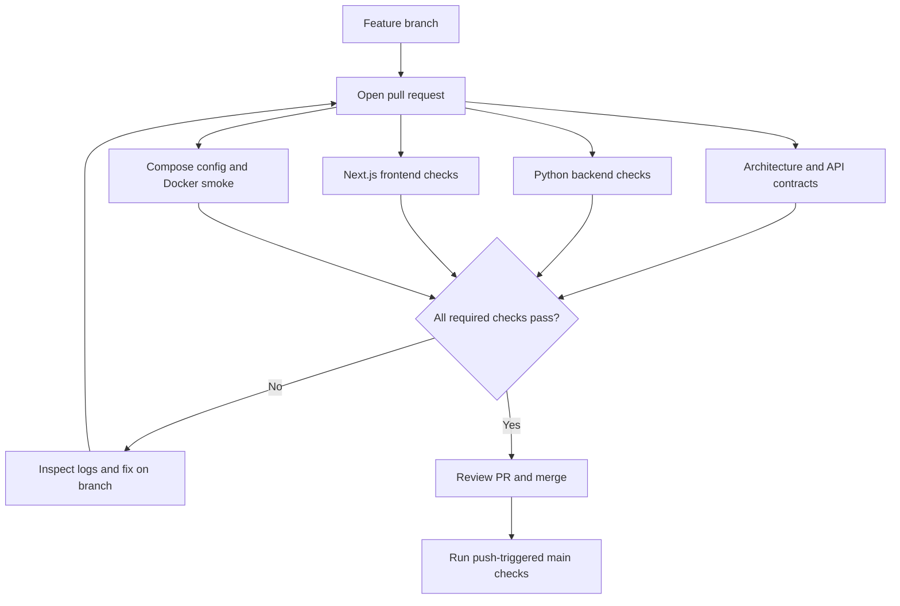

# GitHub Automation and CI — DermaLens AI

This directory contains the **GitHub Actions automation** for DermaLens AI. It is not the project's main README.

**Start here:** [Project overview](../README.md) · [Source and architecture](../docs/01_SYSTEM_ARCHITECTURE.md) · [Persistent development tracker](../GEMINI.md) · [Deployment instructions](../docs/RECRUITER_DEPLOYMENT.md)

## Why this directory exists

DermaLens has a Next.js frontend, a FastAPI backend, research utilities and optional integrations. CI checks that code changes do not break shared contracts, type checks, tests or container packaging before they reach the default branch.

**These checks validate software engineering, not medical accuracy.** A successful workflow does not imply that the six-class disease classifier is connected, externally validated or deployed as a medical service.

## What runs automatically?

| Workflow | Trigger | What it checks |
| --- | --- | --- |
| [Phase 0 — Architecture contracts](workflows/phase0.yml) | Pull requests; pushes to `main` and the original Phase 0 branch | Python lint, required architecture documents, model manifest schema, OpenAPI contract tests |
| [Phase 1 — Backend and frontend](workflows/phase1.yml) | Pull requests; pushes to `main` and the original Phase 1 branch | Python setup, Ruff, formatting, mypy, pytest, repository hygiene; web npm install, ESLint, Vitest, Next.js production build and TypeScript |
| [Phase 8 — Container configuration](workflows/phase8-compose.yml) | Pull requests; pushes to `main` | Valid Compose configuration and exclusions for credentials, face datasets and model weights |
| [Phase 12 — Disposable Docker staging smoke](workflows/phase12-staging-smoke.yml) | Pull requests; manual `workflow_dispatch` | Build/run local Docker services, apply real database migrations, check API liveness, intentional fail-closed model readiness, and web response; clean up disposable CI containers |

The exact workflow definitions—not this summary—are the source of truth for job names, triggers and steps.

## CI workflow at a glance



No workflow here publishes a medical inference model or automatically provides a public Vercel URL. Deployment is a separate, explicitly configured process.

## How to contribute

1. Read the [root README](../README.md), [GEMINI.md](../GEMINI.md), and relevant [architecture documentation](../docs/01_SYSTEM_ARCHITECTURE.md).
2. Create a feature branch from the latest `main`. Preserve any existing uncommitted changes.
3. Make a focused change, add or update meaningful tests, and run the corresponding local commands below.
4. Open a pull request and check the [Actions page](https://github.com/shanmukhdatta/DermaLens-AI/actions) for **that PR's exact commit**.
5. Fix failing checks. Record what passed, what is blocked, and what was not tested. Merge only after review and the required green CI results.
6. Update `GEMINI.md` with verified progress, remaining work and the next task when the change affects project status.

See the child [workflows reference](workflows/README.md) for common failure diagnosis.

## Run checks locally

From the repository root with Python 3.11 and `uv`:

```bash
uv sync --python 3.11 --frozen --all-groups
uv pip install --python .venv/bin/python -r requirements-persistence.txt -r requirements-cv.txt -r requirements-rag.txt
uv run --frozen --no-sync ruff check .
uv run --frozen --no-sync ruff format --check apps packages services tests/test_api_foundation.py tests/test_phase2_backend.py
uv run --frozen --no-sync mypy
uv run --frozen --no-sync python -m scripts.validate_phase0
uv run --frozen --no-sync python -m pytest -q
uv run --frozen --no-sync python scripts/check_repository_hygiene.py
```

From `apps/web/` with Node.js 22+:

```bash
npm ci
npm run lint
npm test
npm run build
npm run typecheck
```

To validate a **disposable** local Docker stack, see [infra/docker/README.md](../infra/docker/README.md) and [the staging workflow](workflows/phase12-staging-smoke.yml). Do not use `docker compose down --volumes` on a development database whose contents you need.

## Security and release boundaries

- Never commit `.env` files, passwords, authentication tokens, encryption keys, patient photographs, private datasets, or trained model checkpoints.
- Keep the original research training dependencies separate from the FastAPI and Next.js production images.
- Check the exact SHA of tested code before claiming a green build. CI output may contain warnings that need follow-up.
- **Public model inference remains disabled.** The classifier needs real authorized weights, exact label ordering, parity verification and independent evaluation before any research activation, and clinical deployment requires separate safety/legal review.
- Vercel web deployment and optional container API deployment are independent; neither happens just because this CI folder exists.

## Current verified context

On **October 25, 2026**, engineering PR [#37](https://github.com/shanmukhdatta/DermaLens-AI/pull/37) passed 133 Python tests and 17 frontend tests, plus build/static checks and Docker smoke. Later documentation PRs [#38](https://github.com/shanmukhdatta/DermaLens-AI/pull/38) and [#39](https://github.com/shanmukhdatta/DermaLens-AI/pull/39) were merged following passing checks. Recheck the current [Actions runs](https://github.com/shanmukhdatta/DermaLens-AI/actions) before relying on this dated snapshot.

**For the latest task-level progress, use [GEMINI.md](../GEMINI.md)—not this CI documentation.**
