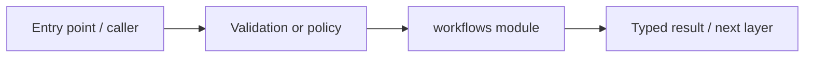

# .github/workflows — module technical guide

## Purpose and scope

Github Actions lint/build/Compose checks. Status: **Local browser, live OIDC and medical validation are separate**. See root README and `docs/FINAL_FEATURE_AUDIT.md` for the release state.

## Direct file index

- `phase0.yml` — module source or configuration
- `phase1.yml` — module source or configuration
- `phase12-staging-smoke.yml` — module source or configuration
- `phase8-compose.yml` — module source or configuration

## Architecture and internal workflow

GitHub event -> workflows -> lint/build/smoke -> status.



## Public interfaces and integration

phase0.yml, phase1.yml, phase8-compose.yml, phase12-staging-smoke.yml. Consumers should use these boundaries rather than bypassing permissions, model integrity checks or consent.

## Dependencies and configuration

GitHub-hosted runner and permissible secrets. Do not commit secrets, patient photographs, model checkpoints or other sensitive artifacts.

## Verification

Run from repository root unless the command is an npm script (run npm scripts from `apps/web`):

```bash
Inspect runs for exact commit SHA
```

These are **recommended commands**, not a claim they were executed during this documentation change. Record commit SHA, test output and independent integration evidence before changing audit state.
