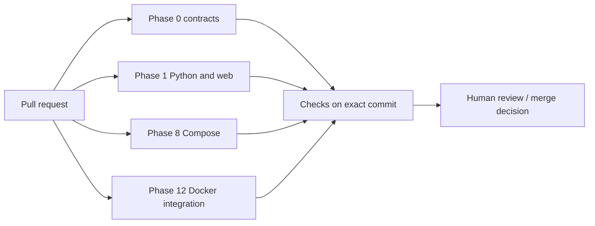

# GitHub Actions Workflow Reference

This folder contains the actual CI configurations used by DermaLens AI. For the overall project and its features, read the [root README](../../README.md). For active tasks and unfinished integrations, read [GEMINI.md](../../GEMINI.md).

## Workflow inventory

| File | Runs on | Jobs and acceptance scope |
| --- | --- | --- |
| [`phase0.yml`](phase0.yml) | PR / `main` and original Phase 0 branch push | Install Python 3.11 + development requirements; run Ruff, `scripts/validate_phase0.py` and Phase 0 contract tests |
| [`phase1.yml`](phase1.yml) | PR / `main` and original Phase 1 branch push | **Backend / contracts:** locked uv environment and extensions, Ruff, formatting, mypy, contract check, pytest, tracked-file hygiene. **Web:** Node.js 22, npm ci, lint, Vitest, Next.js build, TypeScript |
| [`phase8-compose.yml`](phase8-compose.yml) | PR / `main` push | Validate `compose.yaml` with synthetic CI credentials; assert sensitive file exclusions in `.dockerignore` |
| [`phase12-staging-smoke.yml`](phase12-staging-smoke.yml) | PR / manual dispatch | Start disposable local Docker stack, apply database migrations, run operational HTTP smoke and teardown including CI-only volumes |

### Execution

**Phase 12 explicitly tears down test volumes in disposable CI.** Never copy that destructive cleanup step to a persistent database.

## Investigating a failed check

1. Open the [repository Actions page](https://github.com/shanmukhdatta/DermaLens-AI/actions), select the workflow and inspect the **failing job and step logs** for the PR's exact head SHA.
2. For Python failures, run the equivalent Ruff, mypy, pytest, or contract validation command locally from the repository root. Preserve the actual stack trace and fix the relevant source or test.
3. For web failures, run `npm ci` and the failing script in `apps/web`. Verify the correct Node.js version and lockfile.
4. For container failures, check `docker compose config -q`, local build logs and database migrations. Keep images, credentials and model weights out of logs and Git.
5. Push the reviewed fix, rerun checks and document any skipped external verification. **A green CI run is not a clinically validated classifier or proof of production readiness.**

The command set and exact CI steps are in the workflow YAML files. Longer local testing and deployment instructions live in [GEMINI.md](../../GEMINI.md), [engineering handoff](../../docs/FINAL_ENGINEERING_HANDOFF.md) and [recruiter deployment guide](../../docs/RECRUITER_DEPLOYMENT.md).

## Operational safeguards

- GitHub workflow definitions have `contents: read` permissions; do not widen privileges without documented need and review.
- These CI pipelines do **not** require real patient data, a trained medical model or production credentials to validate application packaging.
- No workflow here is an automatic public/medical release pipeline. Vercel and optional FastAPI hosting require separate setup, real smoke tests and appropriate release review.
- When introducing new workflows, keep least-privilege permissions, avoid untrusted third-party execution with secrets, pin reviewed dependencies/actions where practical, and add the workflow to this index.
