# DermaLens AI — Facial Skin Disease AI Platform

> **Phase 0 implementation note (2026-10-13):** The agreed 14-phase execution roadmap (Phase 0–13) lives in [docs/PHASE_TRACKER.md](docs/PHASE_TRACKER.md); it supersedes the older conceptual phase list in Section 50 for execution order. For implementable contracts and decisions see [docs/01_SYSTEM_ARCHITECTURE.md](docs/01_SYSTEM_ARCHITECTURE.md), [docs/08_API_AND_DATA_FLOW.md](docs/08_API_AND_DATA_FLOW.md), [docs/03_MODEL_AND_RESEARCH.md](docs/03_MODEL_AND_RESEARCH.md) and [docs/adr/README.md](docs/adr/README.md). Phase 0 is architecture/docs only: **no clinical diagnostic validation, production classifier or deployed app** is claimed.


## Development workspace — merged engineering implementation (model not connected)

The current branch contains a runnable **engineering skeleton only**, not working facial-skin inference. Backend health returns `200 {"status":"ok"}`; readiness deliberately returns `503 {"status":"not_ready"}`. The versioned model status route is protected by a fail-closed identity verifier, not real login. The frontend states that image analysis is disabled. No image upload, login, feedback, persistence or chatbot functionality is operational.

For Windows/Antigravity and CI commands see [Phase 1 implementation instructions](docs/PHASE1_IMPLEMENTATION.md). Phase 2 implementation and validation are in [Phase 2 implementation](docs/PHASE2_IMPLEMENTATION.md) and [Phase 2 validation](docs/PHASE2_VALIDATION.md); subsequent persistence work is described in [Phase 3 handoff](docs/PHASE3_HANDOFF.md). Source contracts and medical/privacy boundaries from Phase 0 remain authoritative.

> **Status:** Architecture-first new repository  
> **Purpose:** Build a production-style AI platform around previously trained facial skin-condition classifiers while keeping the original research repository unchanged.  
> **Scope:** Computer vision inference, backend services, model serving, explainability, uncertainty handling, user feedback, controlled continual learning, documentation-grounded RAG assistant, observability, privacy, MLOps, and deployment.

---

**Implementation audit (2026-10-14):** See [README feature-by-feature audit](docs/README_FEATURE_AUDIT.md) and [final engineering verification handoff](docs/FINAL_ENGINEERING_HANDOFF.md). Phase 3–13 implementation PRs have merged, but the complete Version 1 Definition of Done in section 51 has **not** been met: real checkpoint verification, analysis serving, model-domain evaluation, calibration, alignment/ROI, user sign-in and production security still need work. The current website offers image suitability checks, documentation exploration and engineering information. **No real skin diagnosis is enabled.**

## 1. Executive Summary

DermaLens AI is a new, independent AI engineering project that turns an existing facial skin-condition classification research pipeline into a production-style platform.

The original research repository remains the source of truth for the research pipeline, synthetic-data generation, training strategy, preprocessing assumptions, evaluation logic, and exported model artifacts. This repository does **not** modify that research repository.

The new platform focuses on the engineering required to serve and operate those models safely and reliably:

- Accept a facial image from a web/mobile interface.
- Validate that the image is usable.
- Detect and align the face.
- Extract the relevant facial/skin region.
- Apply the exact model-compatible preprocessing.
- Run inference using a registered model artifact.
- Return class probabilities rather than only a label.
- Estimate confidence and uncertainty.
- Detect unsuitable or out-of-distribution inputs.
- Generate model explanations such as Grad-CAM where supported.
- Return a structured analysis result.
- Store analysis metadata and optional user history.
- Collect optional feedback.
- Route validated feedback into a controlled continual-learning workflow.
- Provide a documentation-grounded RAG assistant powered through a Grok provider adapter.
- Track model versions, latency, failures, drift signals, and feedback statistics.
- Keep medical-safety, privacy, and human review boundaries explicit.

This is intended to demonstrate end-to-end skills across:

- Computer Vision Engineering
- AI / ML Engineering
- Data Science
- Backend Engineering
- MLOps
- RAG / LLM Engineering
- System Design
- AI Architecture
- Observability
- Privacy and Responsible AI

---

## 2. Important Boundary

This repository is an **engineering and research platform**, not a validated medical diagnostic device.

The system may classify an image into one of the skin-condition categories represented by the underlying model, but:

- model performance depends on the training and evaluation data,
- synthetic-to-real domain shift may reduce real-world performance,
- confidence scores are not equivalent to clinical certainty,
- explainability maps do not prove medical correctness,
- user feedback is not treated as ground truth unless validated,
- low-confidence or out-of-distribution cases should be allowed to abstain,
- the product should encourage professional evaluation for concerning or uncertain cases.

The platform must prefer:

```text
"I cannot assess this image reliably."
```

over forcing a confident-looking prediction.

---

# 3. Relationship to the Existing Research Repository

Existing research repository:

```text
shanmukhdatta/Facial_Skin_Diesease
```

This new repository is separate.

```text
Research Repository
        │
        │ exports / references
        ▼
Model Artifacts + Label Map + Preprocessing Contract
        │
        ▼
DermaLens AI Platform
```

The new platform should consume only the artifacts and documented contracts required for inference.

It should not copy the entire research project into the production repository.

---

## 4. Verified Research-Pipeline Facts to Preserve

The following are verified from the existing repository and should be treated as the current compatibility contract.

### 4.1 Current class space

The current research project is organized around six top-level classes:

```text
Acne
Fungal Infection
Hyperpigmentation
Normal Skin
Skin Cancer
Vitiligo
```

Skin-cancer generation in the research workflow additionally uses:

```text
BCC
SCC
Melanoma
```

These subtypes must **not** automatically be exposed as subtype predictions unless the deployed model artifact actually produces subtype outputs.

Likewise, synthetic generation may vary severity, but the production application must not claim to predict severity unless a validated severity model exists.

---

## 4.2 Verified inference preprocessing contract

The existing single-image inference pipeline performs:

```text
Input Image
    ↓
PIL Load
    ↓
Convert to RGB
    ↓
Resize to 224 × 224
    ↓
Convert to float32
    ↓
Clip to [0, 255]
    ↓
Add batch dimension
    ↓
Model-internal preprocessing
    ↓
Model prediction
```

The production platform must preserve this model compatibility.

The current models accept raw `float32` RGB input in `[0,255]`, and preprocessing is handled inside the serialized model or backbone-specific preprocessing layer.

Examples from the research codebase:

```text
ResNet50       → ResNet50-specific preprocess_input
DenseNet121    → DenseNet121-specific preprocess_input
EfficientNetV2 → preprocessing enabled internally
MobileNetV3    → preprocessing enabled internally
ViT-B/16       → [0,255] → [-1,1]
```

Therefore, the production pipeline should **not add a second normalization step** before inference unless a future model explicitly requires it.

---

## 4.3 Verified training-time augmentation

The research training pipeline includes mild augmentation:

```text
Horizontal Flip
Random Rotation
Random Zoom
Random Contrast
Random Brightness
Random Translation
```

These are **training-time augmentations**, not production inference transformations.

---

## 4.4 Verified model-family support in the research codebase

The research repository supports these backbone definitions:

```text
EfficientNetV2B0
ResNet50
DenseNet121
MobileNetV3Large
ViT-B16
```

The production platform should not assume that every supported architecture has a deployable checkpoint.

Only explicitly exported and validated artifacts should enter the production model registry.

---

# 5. Product Goals

The platform should demonstrate the full lifecycle of an AI system rather than only classification.

## Primary goals

1. Build a robust production-style computer-vision inference pipeline.
2. Serve existing trained model artifacts without retraining them during v1.
3. Add image-quality validation before model inference.
4. Support face detection and alignment.
5. Add uncertainty and abstention behavior.
6. Add explainable-AI outputs where technically supported.
7. Build a clean backend API around the model.
8. Store analysis history and model-version metadata.
9. Collect user feedback without treating it as immediate truth.
10. Build a controlled continual-learning path.
11. Build a documentation-only RAG assistant.
12. Add observability and model monitoring.
13. Prepare the platform for cloud/container deployment.
14. Keep all subsystems independently understandable during interviews.

---

# 6. Non-Goals for Version 1

Version 1 will **not**:

- retrain the original classifier on every user interaction,
- allow unverified user feedback to directly alter model weights,
- claim clinical diagnosis,
- claim treatment recommendations,
- claim severity prediction unless a validated severity model is available,
- claim subtype prediction unless the deployed model supports subtype outputs,
- use reinforcement learning merely as a label for feedback collection,
- index the entire source code into the RAG assistant,
- add distributed technologies unless the product actually needs them.

---

# 7. End-to-End Product Flow

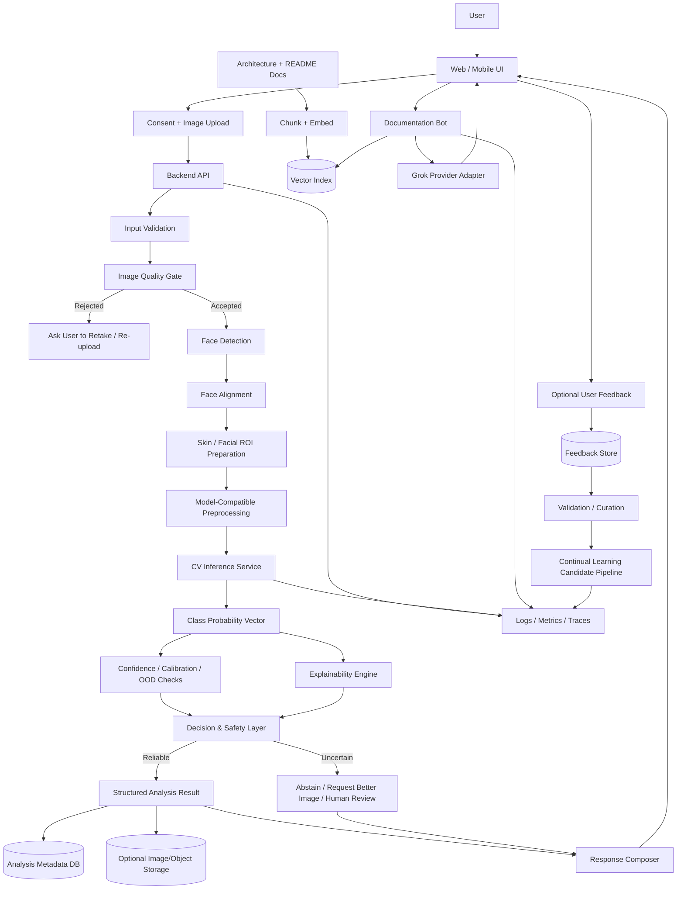

---

# 8. Computer Vision Architecture

The computer-vision layer is the core inference path.

It should be treated as a separate service/module with a clear contract.

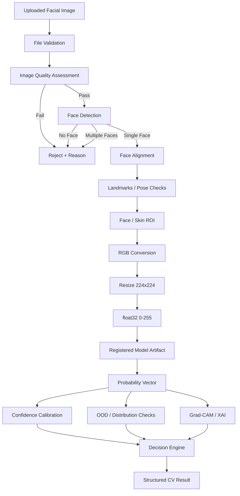

---

## 8.1 Input validation

Validate before expensive computer-vision processing.

Possible checks:

```text
Supported file type
File can be decoded
File is not empty/corrupt
Resolution is within allowed bounds
File size is within allowed bounds
Image contains expected channel information
Image is not obviously malformed
```

No classification should occur if decoding fails.

---

## 8.2 Image-quality gate

The model should not be forced to classify every upload.

Quality features may include:

```text
Blur / sharpness
Brightness
Underexposure
Overexposure
Contrast
Face visibility
Face size
Pose angle
Occlusion
Motion blur
Heavy crop
Multiple faces
Strong filter / non-photographic appearance
```

Example result:

```json
{
  "accepted": false,
  "quality_score": 0.42,
  "reasons": [
    "face_too_small",
    "image_blurry"
  ]
}
```

The UI should then ask the user to capture a better image.

---

## 8.3 Face detection

Purpose:

- confirm that a usable face exists,
- reject images with no face,
- reject or handle multiple faces,
- produce a face bounding box,
- pass the selected face to alignment.

The detector should be independent from the disease classifier.

---

## 8.4 Face alignment

Alignment should normalize pose as much as possible before classification.

Possible signals:

```text
Eye landmarks
Nose landmark
Mouth landmarks
Head roll
Head yaw
Head pitch
```

Alignment should be conservative.

Do not distort skin texture unnecessarily.

---

## 8.5 Facial skin / ROI processing

The v1 goal is not necessarily full lesion segmentation.

The ROI stage can begin with:

```text
Detected face crop
Optional exclusion of background
Optional masking of eyes / lips / hair if justified
Preserve skin texture
Preserve color information
Preserve lesion morphology
```

Any additional preprocessing must be tested to ensure it does not create a distribution mismatch with the training pipeline.

---

## 8.6 Model-compatible preprocessing

This stage must preserve compatibility with the research models.

```text
Face / ROI
   ↓
RGB
   ↓
224 × 224
   ↓
float32
   ↓
pixel range [0,255]
   ↓
serialized model
   ↓
model-internal preprocessing
```

Critical rule:

> Do not normalize twice.

---

## 8.7 Inference service

The inference service owns:

```text
Model loading
Warm startup
Model version selection
Label-map loading
Tensor preparation
Forward pass
Probability extraction
Latency measurement
Error handling
```

Example internal response:

```json
{
  "model_name": "registered_model_name",
  "model_version": "v1.0.0",
  "predicted_class": "Acne",
  "confidence": 0.81,
  "probabilities": {
    "Acne": 0.81,
    "Fungal Infection": 0.06,
    "Hyperpigmentation": 0.05,
    "Normal Skin": 0.04,
    "Skin Cancer": 0.02,
    "Vitiligo": 0.02
  }
}
```

The numbers above are an example schema only, not claimed model performance.

---

# 9. Uncertainty, Calibration, and Abstention

A production AI system should know when it should not make a strong claim.

The decision layer should consider:

```text
Top probability
Margin between top-1 and top-2
Calibration score
Image-quality score
Out-of-distribution score
Model disagreement if an ensemble is used
Known failure rules
```

Possible output states:

```text
HIGH_CONFIDENCE_RESULT
LOW_CONFIDENCE_RESULT
OUT_OF_DISTRIBUTION
INSUFFICIENT_IMAGE_QUALITY
UNSUPPORTED_INPUT
HUMAN_REVIEW_RECOMMENDED
```

Example:

```json
{
  "decision": "LOW_CONFIDENCE_RESULT",
  "predicted_class": "Hyperpigmentation",
  "confidence": 0.49,
  "message": "The model is not sufficiently confident to provide a reliable automated classification."
}
```

---

# 10. Synthetic-to-Real Domain Shift

This is a first-class engineering problem.

The research workflow contains significant synthetic-data work, while production users will provide real phone-camera images.

Potential differences include:

```text
Lighting
Camera sensor
Compression
Skin tone distribution
Pose
Makeup
Filters
Background
Image sharpness
Resolution
Color balance
Occlusion
Disease presentation
```

The platform should therefore monitor:

```text
Confidence distribution
OOD score distribution
Input-quality distribution
Per-class prediction frequency
User disagreement rate
Validated error rate
Device / acquisition metadata where privacy allows
```

The goal is not to hide domain shift.

The goal is to detect and manage it.

---

# 11. Explainable AI Architecture

Where the deployed model supports it, the system may provide an explanation map such as Grad-CAM.

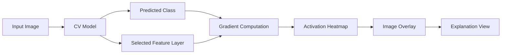

Explainability output should be described as:

```text
"Region that influenced the model prediction"
```

and not:

```text
"Proof that the disease exists here"
```

---

# 12. Model Artifact Registry

The new repository should treat models as versioned artifacts.

Example registry metadata:

```yaml
model_id: facial-skin-classifier
version: 1.0.0
framework: tensorflow
input_size: [224, 224, 3]
input_dtype: float32
input_range: [0, 255]
labels:
  - Acne
  - Fungal Infection
  - Hyperpigmentation
  - Normal Skin
  - Skin Cancer
  - Vitiligo
preprocessing: model_internal
source: research_repository
artifact_uri: <configured-at-deployment>
checksum: <sha256>
status: staging
```

Every inference result should record:

```text
model_id
model_version
preprocessing_version
pipeline_version
timestamp
```

This makes predictions reproducible.

---

# 13. Model Training / Research Architecture

The new platform does not need to retrain the original model during initial implementation.

However, the system documentation should preserve the research training architecture and define how future model versions enter production.

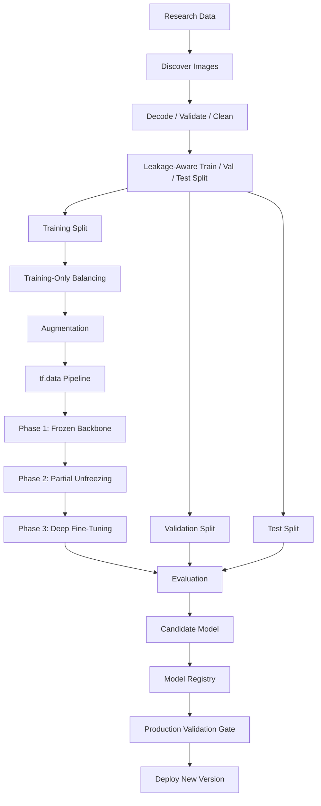

Verified research strategy includes:

```text
Phase 1 → frozen backbone / classification-head warm-up
Phase 2 → partial backbone unfreezing
Phase 3 → deeper fine-tuning
```

The production repository should reference this training lifecycle but should not pretend that training happens online.

---

# 14. Model Promotion Rules

A candidate model must not replace the production model because its training run completed successfully.

Promotion should require:

```text
Artifact integrity check
Label-map compatibility
Preprocessing compatibility
Held-out evaluation
Regression comparison against current production model
Calibration evaluation
Latency check
Memory check
Failure-case review
Safety review
Approval / promotion step
```

Possible lifecycle:

```text
candidate
   ↓
staging
   ↓
shadow
   ↓
canary
   ↓
production
   ↓
archived
```

---

# 15. Backend Architecture

The backend should remain separate from the CV internals.

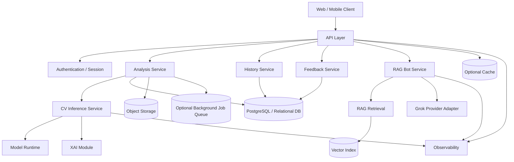

---

## 15.1 Backend responsibilities

The backend owns:

```text
Authentication / authorization
Upload handling
Request validation
Analysis orchestration
Inference-service communication
Result persistence
History retrieval
Feedback submission
RAG requests
Rate limiting
Error mapping
Audit events
Observability
Privacy controls
```

The backend should not duplicate model logic.

---

## 15.2 Suggested service boundaries

Initial implementation can remain a modular monolith while preserving clean boundaries:

```text
API Layer
Analysis Module
CV Module
Model Runtime
Feedback Module
RAG Module
Persistence Module
Observability Module
```

Only split into separate deployed microservices when there is a real operational reason.

This avoids unnecessary distributed-system complexity in the first version.

---

# 16. Proposed Backend Request Flow

```text
POST /analyses
      │
      ▼
Validate request
      │
      ▼
Create analysis record
      │
      ▼
Send image to CV pipeline
      │
      ▼
Receive structured CV result
      │
      ▼
Apply response / safety rules
      │
      ▼
Persist metadata
      │
      ▼
Return analysis response
```

---

# 17. Proposed API Surface

The exact implementation may change, but the system should be designed around clear contracts.

```text
POST   /api/v1/analyses
GET    /api/v1/analyses/{analysis_id}
GET    /api/v1/analyses
POST   /api/v1/analyses/{analysis_id}/feedback

POST   /api/v1/copilot/query

GET    /api/v1/models/current
GET    /api/v1/health
GET    /api/v1/readiness
```

Administrative endpoints, if implemented, must be access-controlled.

---

# 18. Analysis Result Contract

Example schema:

```json
{
  "analysis_id": "uuid",
  "status": "completed",
  "input_quality": {
    "accepted": true,
    "score": 0.87,
    "flags": []
  },
  "face": {
    "detected": true,
    "count": 1
  },
  "prediction": {
    "class": "Acne",
    "confidence": 0.81,
    "probabilities": {}
  },
  "uncertainty": {
    "decision": "LOW_CONFIDENCE_RESULT",
    "ood_score": null
  },
  "explainability": {
    "available": true,
    "artifact_id": "optional"
  },
  "model": {
    "id": "facial-skin-classifier",
    "version": "1.0.0"
  },
  "created_at": "ISO-8601"
}
```

Again, this is a schema example, not a claim about actual prediction scores.

---

# 19. Data Architecture

The platform should separate:

```text
Application metadata
Model metadata
Analysis metadata
Feedback
Raw image objects
Generated explanation artifacts
RAG documents
Vector embeddings
Observability data
```

Suggested logical stores:

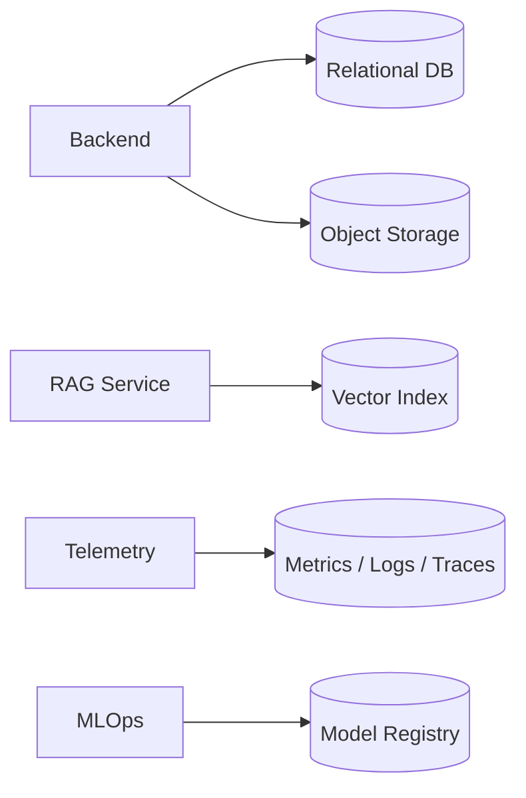

---

# 20. Privacy-First Image Storage

Facial images are sensitive.

The system should support configurable retention modes.

Possible modes:

```text
Mode A: Process and immediately delete raw image
Mode B: Store temporarily for user history
Mode C: Store only after explicit consent for research / improvement
```

The safest default for a placement/demo system is:

```text
process → derive result → delete raw image
```

unless the user explicitly chooses history or research contribution.

Any stored image should use:

```text
Access control
Encryption at rest
Encryption in transit
Short-lived signed access links
Retention policy
Deletion workflow
Audit events
```

---

# 21. User History

If the user enables history, store the analysis event rather than only the image.

Possible history record:

```text
Analysis ID
Timestamp
Prediction
Confidence
Uncertainty state
Quality score
Model version
Pipeline version
Optional explanation reference
Optional user feedback
```

This allows longitudinal product behavior without requiring indefinite raw-image retention.

---

# 22. Feedback Architecture

User feedback is useful but untrusted.

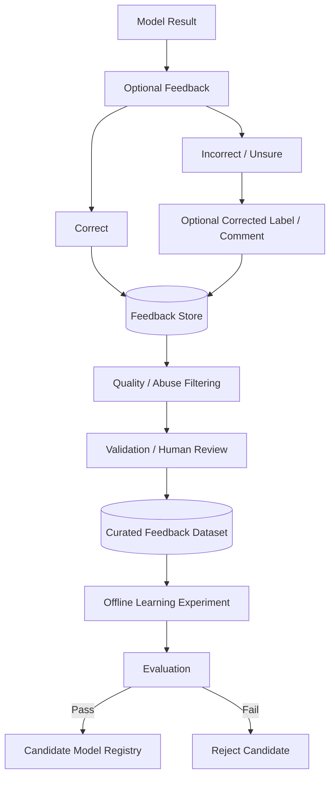

---

## 22.1 Feedback types

Possible feedback:

```text
Correct
Incorrect
Unsure
Image-quality issue
Different condition suggested
General comment
Clinician-verified correction
```

Feedback confidence levels should be different.

Example:

```text
anonymous_user_feedback       → low trust
authenticated_user_feedback   → low / medium trust
repeated_consistent_feedback  → medium trust
clinician_verified_feedback   → high trust
researcher_verified_label     → high trust
```

---

# 23. Continual Learning Strategy

Version 1 should use **controlled continual learning**, not immediate online retraining.

```text
Production Model
      │
      ▼
User Interactions
      │
      ▼
Feedback Store
      │
      ▼
Validation
      │
      ▼
Curated Real-World Dataset
      │
      ▼
Offline Experiment
      │
      ▼
Candidate Model
      │
      ▼
Evaluation Gate
      │
      ▼
Model Registry
      │
      ▼
Controlled Deployment
```

This workflow creates a strong AI-engineering and MLOps story without corrupting the production model.

---

# 24. Feedback-Aware Secondary Model

An optional future extension is to keep the original CV classifier frozen and train a smaller secondary component.

Example:

```text
Frozen CV Model
      │
      ▼
Probability Vector
      │
      ├─────────────┐
      │             │
      ▼             ▼
Calibration     Context Features
      │             │
      └──────┬──────┘
             ▼
Feedback-Aware Re-ranker
             │
             ▼
Adjusted Decision
```

This component could learn:

```text
Calibration corrections
Class-specific confidence behavior
Known failure-pattern penalties
Abstention thresholds
Model-routing decisions
```

It must be evaluated offline before deployment.

---

# 25. Reinforcement Learning — Optional Research Extension

The feedback workflow itself should not be mislabeled as reinforcement learning.

A genuine RL or contextual-bandit extension would require:

```text
State
Action
Reward
Policy
Offline / safe evaluation
```

One defensible future formulation is:

### State

```text
Model probability vector
Image-quality features
OOD score
Calibration score
Model disagreement
Previous validated feedback statistics
```

### Actions

```text
Return result
Return low-confidence result
Ask user to retake image
Abstain
Route for human review
```

### Reward

Reward must come from **validated outcomes**, not raw user clicks.

Example conceptually:

```text
validated correct decision       → positive reward
unsafe overconfident decision    → strong negative reward
correct abstention               → positive reward
unnecessary abstention           → small negative reward
```

This is an experimental research module, not part of the initial production path.

---

# 26. Documentation-Grounded RAG Assistant

The platform includes a small developer / architecture bot.

Its job is to explain how the platform works.

It is **not** the medical classifier.

It is **not** a general-purpose medical assistant.

It is grounded only in curated project documentation.

---

## 26.1 RAG knowledge source

Recommended documentation set:

```text
README.md
docs/01_SYSTEM_ARCHITECTURE.md
docs/02_COMPUTER_VISION_PIPELINE.md
docs/03_MODEL_AND_RESEARCH.md
docs/04_BACKEND_ARCHITECTURE.md
docs/05_RAG_ASSISTANT.md
docs/06_FEEDBACK_AND_CONTINUAL_LEARNING.md
docs/07_MLOPS_AND_DEPLOYMENT.md
docs/08_API_AND_DATA_FLOW.md
docs/09_PRIVACY_AND_SAFETY.md
```

---

## 26.2 RAG architecture

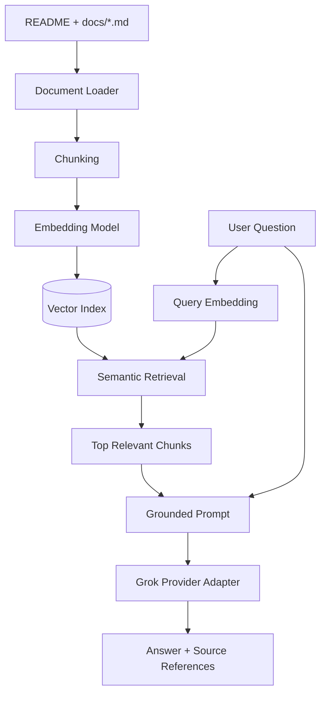

---

## 26.3 RAG rules

The assistant should:

```text
Answer only from indexed documentation when possible
Cite the source document / section
Say when the answer is not documented
Never pretend to inspect live code unless code indexing is later enabled
Never modify the CV result
Never provide a new skin diagnosis
Never use chat history as hidden medical ground truth
```

---

# 27. Grok Provider Adapter

The RAG layer should not tightly couple the application to one API client.

Use an interface such as:

```text
LLMProvider
    ├── generate(context, question)
    ├── healthcheck()
    └── metadata()
```

Then implement:

```text
GrokProvider
```

This makes the architecture testable and allows provider substitution without changing the rest of the RAG system.

---

# 28. RAG Ingestion Pipeline

Documentation indexing should be reproducible.

```text
docs/*.md
   ↓
load
   ↓
clean
   ↓
split by heading / semantic chunk
   ↓
attach metadata
   ↓
embed
   ↓
upsert into vector index
```

Chunk metadata should contain:

```text
document_name
section
heading_path
chunk_id
content_hash
version
```

When documentation changes, re-index only changed chunks where possible.

---

# 29. MLOps Architecture

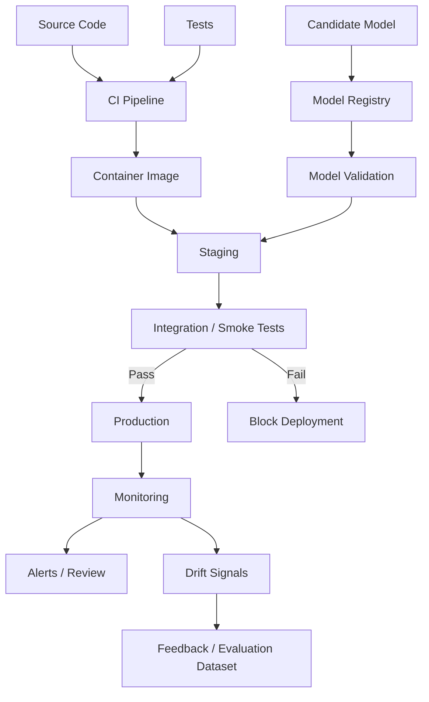

---

# 30. What Must Be Versioned

Version:

```text
Model artifact
Label map
Preprocessing contract
CV pipeline
Backend API
RAG document index
Prompt template
Embedding model
Feedback schema
Database schema
Deployment image
```

An analysis result must be traceable to the versions that created it.

---

# 31. Observability

The project should include three forms of telemetry.

### Logs

```text
Request ID
Analysis ID
Model version
Pipeline stage
Error details
Security / audit events
```

### Metrics

```text
Request count
Error rate
API latency
Inference latency
Image rejection rate
Face-detection failure rate
Low-confidence rate
OOD rate
Prediction-class distribution
Feedback rate
User disagreement rate
RAG retrieval latency
LLM latency
```

### Traces

Trace:

```text
frontend request
→ API
→ image validation
→ CV pipeline
→ inference
→ explainability
→ persistence
→ response
```

This helps prove backend and AI-system engineering competence.

---

# 32. Drift Monitoring

Initial drift monitoring can be lightweight.

Monitor trends in:

```text
Image-quality features
Model confidence
Top-1 / top-2 margin
Class-frequency distribution
Embedding distribution
OOD score
Feedback disagreement
Validated error rate
```

A drift alert should start an investigation.

It should not automatically retrain and deploy a model.

---

# 33. Backend Reliability

The platform should define behavior for failures.

Examples:

```text
Model service unavailable
Model artifact missing
Unsupported image
No face detected
Multiple faces detected
Quality gate failed
Inference timeout
Database unavailable
Object-storage failure
RAG provider unavailable
Vector store unavailable
```

Each error should map to a stable application error code.

---

# 34. Suggested Error Codes

```text
INVALID_IMAGE
UNSUPPORTED_IMAGE_TYPE
IMAGE_TOO_LARGE
IMAGE_QUALITY_TOO_LOW
NO_FACE_DETECTED
MULTIPLE_FACES_DETECTED
FACE_ALIGNMENT_FAILED
MODEL_NOT_READY
INFERENCE_FAILED
LOW_CONFIDENCE
OUT_OF_DISTRIBUTION
RAG_UNAVAILABLE
INTERNAL_ERROR
```

---

# 35. Security Architecture

Minimum security goals:

```text
HTTPS / TLS
Authentication where history is enabled
Authorization for user-owned analyses
Rate limiting
Input-size limits
File-type validation
Malicious-file protection
Secrets through environment / secret manager
No API keys in Git
Encrypted storage
Signed object URLs
Audit events
Retention / deletion policy
Dependency scanning
Container scanning
```

---

# 36. Responsible AI / Safety Layer

The safety layer should sit between raw model output and user-facing response.

```text
Raw Probability Vector
      ↓
Confidence / OOD
      ↓
Quality Context
      ↓
Safety Rules
      ↓
User-Facing Result
```

The system should never convert:

```text
weak model evidence
```

into:

```text
confident medical certainty
```

---

# 37. Frontend Experience

The frontend should guide the user through the pipeline.

Suggested flow:

```text
Landing
  ↓
Consent / Usage Notice
  ↓
Capture or Upload
  ↓
Image Quality Check
  ↓
Processing
  ↓
Result
  ├── Predicted category
  ├── Confidence / uncertainty state
  ├── Explanation visualization
  ├── Limitations
  └── Optional feedback
  ↓
History if enabled
```

The developer RAG bot can appear as a small expandable widget:

```text
"How does this prediction pipeline work?"
"Why was my image rejected?"
"What does OOD mean in this project?"
"Which model preprocessing is used?"
"How does the feedback system work?"
```

The bot answers from documentation.

---

# 38. Complete Combined Runtime Sequence

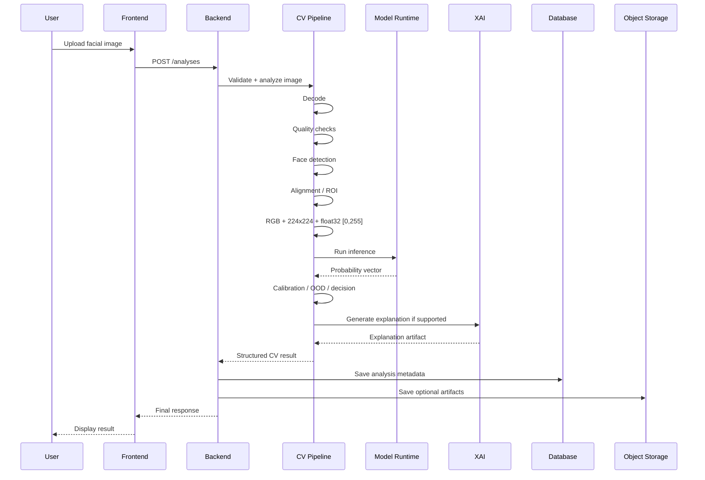

---

# 39. Feedback Runtime Sequence

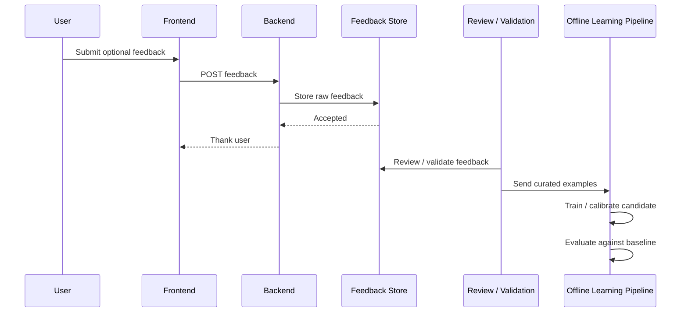

No direct user interaction updates the production model.

---

# 40. RAG Runtime Sequence

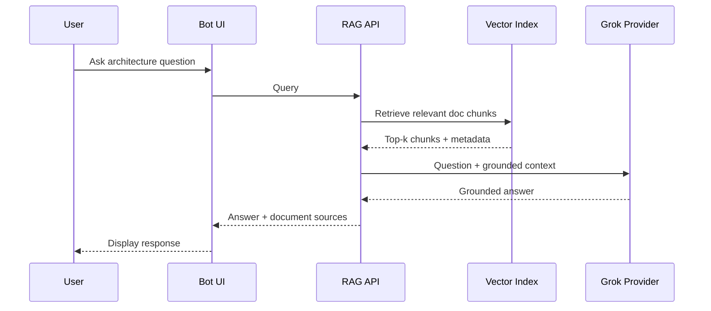

---

# 41. Proposed Repository Structure

```text
dermalens-ai/
│
├── README.md
├── LICENSE
├── .env.example
├── .gitignore
├── docker-compose.yml
│
├── docs/
│   ├── 01_SYSTEM_ARCHITECTURE.md
│   ├── 02_COMPUTER_VISION_PIPELINE.md
│   ├── 03_MODEL_AND_RESEARCH.md
│   ├── 04_BACKEND_ARCHITECTURE.md
│   ├── 05_RAG_ASSISTANT.md
│   ├── 06_FEEDBACK_AND_CONTINUAL_LEARNING.md
│   ├── 07_MLOPS_AND_DEPLOYMENT.md
│   ├── 08_API_AND_DATA_FLOW.md
│   ├── 09_PRIVACY_AND_SAFETY.md
│   └── adr/
│       └── README.md
│
├── apps/
│   ├── web/
│   └── api/
│
├── services/
│   ├── cv/
│   │   ├── quality/
│   │   ├── face_detection/
│   │   ├── alignment/
│   │   ├── preprocessing/
│   │   ├── inference/
│   │   ├── uncertainty/
│   │   ├── explainability/
│   │   └── schemas/
│   │
│   ├── rag/
│   │   ├── ingestion/
│   │   ├── retrieval/
│   │   ├── embeddings/
│   │   ├── providers/
│   │   └── schemas/
│   │
│   └── learning/
│       ├── feedback/
│       ├── curation/
│       ├── calibration/
│       ├── evaluation/
│       └── experiments/
│
├── models/
│   ├── registry/
│   ├── manifests/
│   └── README.md
│
├── packages/
│   ├── contracts/
│   ├── telemetry/
│   ├── security/
│   └── common/
│
├── infra/
│   ├── docker/
│   ├── deployment/
│   ├── monitoring/
│   └── database/
│
├── scripts/
│   ├── verify_model_artifact.py
│   ├── ingest_rag_docs.py
│   ├── evaluate_candidate.py
│   └── smoke_test.py
│
├── tests/
│   ├── unit/
│   ├── integration/
│   ├── e2e/
│   └── model_contract/
│
└── .github/
    └── workflows/
```

This is a target structure.

It can be simplified during the first implementation phase.

---

# 42. Recommended Initial Technology Direction

The architecture should remain technology-aware but not technology-dependent.

A reasonable first implementation can use:

```text
Frontend          → React / Next.js or another modern web client
Backend           → Python FastAPI
CV Runtime        → TensorFlow / Keras
Relational DB     → PostgreSQL
Object Storage    → S3-compatible storage
Vector Store      → pgvector or a dedicated vector database
RAG LLM           → Grok through provider adapter
Containers        → Docker
CI/CD             → GitHub Actions
Model Registry    → lightweight manifest first, MLflow later if needed
Observability     → structured logging + metrics + tracing
```

These are implementation choices, not requirements of the architecture.

Every major change should be documented through an Architecture Decision Record.

---

# 43. Architecture Decision Records

Create:

```text
docs/adr/
```

Each important choice should answer:

```text
Context
Decision
Alternatives
Why selected
Trade-offs
Consequences
```

Example ADRs:

```text
ADR-001 Model preprocessing remains inside serialized model
ADR-002 User feedback cannot directly update production model
ADR-003 Documentation-only RAG scope
ADR-004 Modular monolith before microservices
ADR-005 Raw-image retention policy
ADR-006 Model registry and version contract
```

---

# 44. Testing Strategy

The project should test more than endpoint status codes.

### Unit tests

```text
Image validation
Quality metrics
Preprocessing
Label mapping
Confidence logic
RAG chunking
Feedback validation
```

### Model-contract tests

Verify:

```text
Input shape = 224x224x3
Input dtype = float32
Expected pixel range
Label count
Output probability shape
Probability validity
Model loads with required custom layers
```

### Integration tests

```text
Upload → CV result
CV result → persistence
Feedback → store
RAG query → retrieval
```

### End-to-end tests

```text
Browser upload
Backend processing
Result rendering
Feedback submission
```

### Regression tests

Maintain a small approved evaluation fixture to detect accidental changes in:

```text
preprocessing
model output
label ordering
confidence handling
API response schema
```

---

# 45. Model Evaluation Strategy

Production evaluation should include more than overall accuracy.

Possible metrics:

```text
Accuracy
Macro-F1
Weighted-F1
Per-class precision
Per-class recall
Per-class F1
AUC-ROC where appropriate
Cohen's Kappa
Matthews Correlation Coefficient
Calibration error
Confidence histograms
Abstention coverage
Selective risk
Latency
Memory usage
```

The existing research repository already evaluates several of the classification metrics above.

Production evaluation should add reliability and systems metrics.

---

# 46. Explainability Evaluation

Grad-CAM should not be included only for visualization.

Check:

```text
Is the heatmap stable?
Does it focus on the face?
Does it respond to the predicted class?
Does preprocessing alter the map?
Is explanation generation deterministic enough for debugging?
What happens for unsupported architectures?
```

If XAI cannot be generated safely for a model, the API should return:

```json
{
  "available": false
}
```

rather than fabricating an explanation.

---

# 47. Performance Targets

Targets should be measured, not invented.

During implementation, benchmark:

```text
Image-validation latency
Face-detection latency
Preprocessing latency
Inference latency
XAI latency
End-to-end latency
Peak memory
Cold-start time
RAG retrieval latency
LLM latency
```

Only after measurement should the README publish performance numbers.

---

# 48. Deployment Architecture

Initial deployment can remain simple.

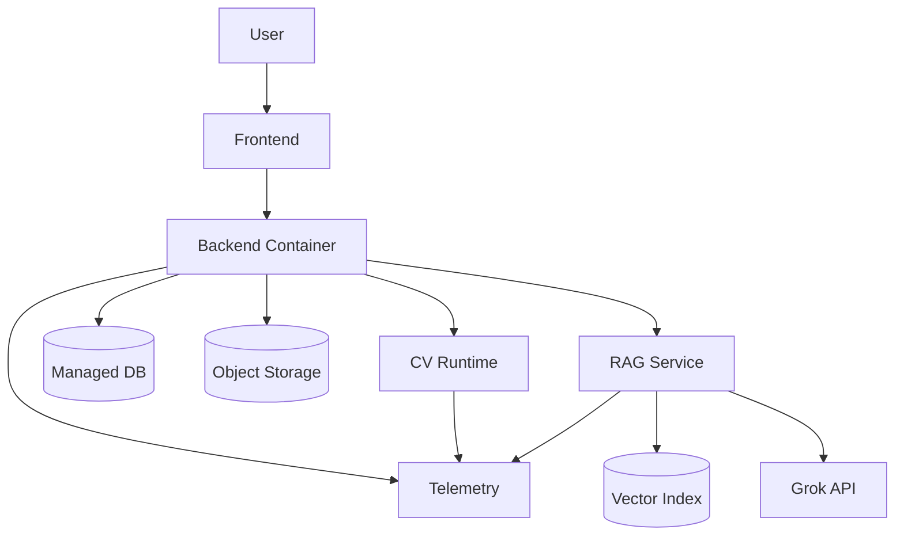

Later scaling options:

```text
Independent CV replicas
GPU-backed inference nodes
Autoscaling
Background XAI jobs
Dedicated RAG service
Managed vector database
Dedicated monitoring stack
```

These should be added only when measurements justify them.

---

# 49. CI/CD Plan

On pull request:

```text
Lint
Type checks
Unit tests
Model-contract tests
Security checks
Build test
```

On merge:

```text
Build container
Run integration tests
Deploy to staging
Run smoke tests
```

On approved release:

```text
Tag version
Promote image
Deploy production
Record release metadata
```

Model deployment should remain independently versioned from normal application deployment.

---

# 50. Build Plan

The project should be built in phases to avoid confusion.

## Phase 0 — Repository Foundation

Deliver:

```text
Repository structure
README
Architecture docs
Environment template
Code-quality configuration
Basic CI
ADR folder
```

---

## Phase 1 — Model Artifact Contract

Deliver:

```text
Export / obtain selected trained model artifact
Export label_map.json
Model manifest
Artifact checksum
Loading test
224x224 input contract test
Prediction smoke test
```

No retraining.

---

## Phase 2 — Core CV Inference

Deliver:

```text
Image decode
RGB conversion
224x224 resize
float32 [0,255]
Model loading
Probability vector
Structured result
```

This phase reproduces research-repo inference behavior first.

---

## Phase 3 — Production CV Front End

Add:

```text
Input validation
Blur / exposure checks
Face detection
Multiple-face rejection
Face alignment
ROI handling
Quality score
```

Every transformation must be checked for compatibility with the trained model.

---

## Phase 4 — Reliability Layer

Add:

```text
Calibration
Confidence policy
Top-1 / top-2 margin
OOD experiment
Abstention logic
Failure states
```

---

## Phase 5 — Explainable AI

Add:

```text
Grad-CAM or compatible method
Explanation artifact generation
Explanation API contract
Frontend overlay
XAI failure handling
```

---

## Phase 6 — Backend Product Layer

Add:

```text
Analysis API
Persistence
History
Authentication if needed
Image retention controls
Result schemas
Rate limiting
Error contracts
```

---

## Phase 7 — Frontend

Add:

```text
Upload / camera flow
Quality guidance
Processing state
Result screen
Confidence / uncertainty display
Explainability view
History
Feedback
RAG bot widget
```

---

## Phase 8 — Feedback System

Add:

```text
Correct / incorrect / unsure
Optional correction
Feedback metadata
Trust level
Validation state
Curation pipeline
```

No automatic model update.

---

## Phase 9 — Documentation RAG Bot

Add:

```text
Markdown loader
Chunking
Embeddings
Vector index
Retrieval
Grok provider
Grounded prompt
Source references
Fallback when documentation does not contain answer
```

Index only curated documentation.

---

## Phase 10 — MLOps and Observability

Add:

```text
Model registry
Model version metadata
Structured logs
Metrics
Tracing
Latency dashboards
Drift signals
Feedback dashboards
Release tracking
```

---

## Phase 11 — Controlled Continual Learning

Only after enough validated feedback exists:

```text
Curated dataset
Calibration / re-ranking experiment
Optional fine-tuning experiment
Offline evaluation
Regression tests
Candidate registry
Controlled promotion
```

---

## Phase 12 — Optional RL / Decision Policy Research

Only if there is a real research question:

```text
Define states
Define actions
Define validated reward
Offline policy evaluation
Safety constraints
Compare against deterministic baseline
```

Do not block the main product on this phase.

---

# 51. Definition of Done for Version 1

Version 1 is complete when:

```text
A user can upload one face image.
The platform validates the image.
The platform detects exactly one face.
The platform runs model-compatible preprocessing.
A registered model produces a probability vector.
The platform applies confidence / uncertainty rules.
The platform can abstain.
The platform returns model and pipeline versions.
The platform can generate XAI output where supported.
The backend persists analysis metadata.
History is available if enabled.
The user can submit optional feedback.
Feedback is stored but does not directly retrain production.
The documentation RAG bot can answer from indexed docs.
The bot returns documentation sources.
Logs and basic metrics exist.
Tests cover the model contract and main API flow.
The system can run through containers in a reproducible environment.
```

---

# 52. Interview / Portfolio Story

The project should be explainable subsystem by subsystem.

### Computer Vision

```text
Input validation
Image quality
Face detection
Alignment
ROI handling
Preprocessing compatibility
Inference
Calibration
OOD
Abstention
Explainability
```

### AI Engineering

```text
Model serving
Artifact contracts
Versioning
Inference optimization
Reliability gates
Human-in-the-loop feedback
RAG
```

### Data Science

```text
Synthetic-data research
Evaluation
Per-class metrics
Calibration
Domain shift
Error analysis
Feedback-data analysis
Drift
```

### Backend Engineering

```text
APIs
Persistence
Authentication
Object storage
Error contracts
Rate limiting
Testing
Observability
```

### MLOps

```text
Model registry
Candidate promotion
Version tracking
CI/CD
Monitoring
Drift detection
Controlled retraining
Rollback
```

### AI Architecture

```text
Subsystem boundaries
End-to-end data flow
Safety gates
Failure handling
Provider abstraction
Scalability decisions
Trade-offs
```

The strongest project story is not:

```text
"I trained a skin classifier."
```

It is:

```text
"I converted a research classifier into a versioned, observable,
feedback-aware, explainable AI platform with production-style
computer vision, backend services, RAG, and controlled MLOps."
```

---

# 53. Documentation Plan

The root README should remain the master map.

Deep implementation details should move into dedicated documents.

```text
README.md
│
├── 01_SYSTEM_ARCHITECTURE.md
│   └── Full product architecture and boundaries
│
├── 02_COMPUTER_VISION_PIPELINE.md
│   └── Quality gate, face pipeline, preprocessing, inference, XAI
│
├── 03_MODEL_AND_RESEARCH.md
│   └── Research repo contract, training, models, metrics
│
├── 04_BACKEND_ARCHITECTURE.md
│   └── APIs, persistence, auth, storage, failures
│
├── 05_RAG_ASSISTANT.md
│   └── Docs ingestion, embeddings, retrieval, Grok integration
│
├── 06_FEEDBACK_AND_CONTINUAL_LEARNING.md
│   └── Feedback trust, curation, learning, optional RL
│
├── 07_MLOPS_AND_DEPLOYMENT.md
│   └── Registry, CI/CD, deployment, observability
│
├── 08_API_AND_DATA_FLOW.md
│   └── Schemas, endpoint contracts, sequences
│
└── 09_PRIVACY_AND_SAFETY.md
    └── Image retention, consent, security, responsible AI
```

These same curated documents become the RAG assistant's knowledge base.

---

# 54. Architectural Principles

When implementing this repository, follow these principles:

```text
Architecture before framework choice
Model compatibility before extra preprocessing
Measure before optimizing
Abstain before guessing
Validate feedback before learning
Version everything that affects a prediction
Keep research and production repositories separate
Keep the medical classifier separate from the RAG bot
Do not add infrastructure only for résumé keywords
Document every important engineering trade-off
Prefer reproducible interfaces over hidden assumptions
```

---

# 55. Final System Summary

DermaLens AI is designed as five major systems working together:

```text
1. Computer Vision System
   Image → Quality → Face → Preprocess → Model → Uncertainty → XAI

2. Backend Product System
   API → Orchestration → Persistence → History → Security

3. Human Feedback / Learning System
   Feedback → Validation → Curated Data → Offline Experiment → Registry

4. Documentation RAG System
   Markdown Docs → Embeddings → Retrieval → Grok → Grounded Answer

5. MLOps / Operations System
   Versioning → CI/CD → Monitoring → Drift → Controlled Promotion
```

The combined platform is:

```text
Facial Image
    ↓
Safe Computer Vision Pipeline
    ↓
Versioned AI Inference
    ↓
Confidence + OOD + Explainability
    ↓
Backend Product Layer
    ↓
User Result
    ↓
Optional Feedback
    ↓
Controlled Learning Lifecycle

and in parallel:

Project Documentation
    ↓
RAG Index
    ↓
Grok-Powered Documentation Assistant
```

---

# 56. Current Project State

At repository initialization:

```text
Research model work           → exists externally
Research preprocessing        → verified and documented
New product repository        → being initialized
Production CV pipeline        → planned
Backend                       → planned
Frontend                      → planned
Uncertainty / OOD             → planned
Explainability                → planned
Feedback system               → planned
Continual learning            → planned
Documentation RAG             → planned
MLOps                         → planned
Deployment                    → planned
Optional RL research          → future
```

This section should be updated as implementation progresses.

---

# 57. Source Research Repository

The initial model/preprocessing contract is derived from:

```text
https://github.com/shanmukhdatta/Facial_Skin_Diesease
```

That repository remains independent.

The new DermaLens AI repository should reference it as research provenance rather than modify it.

---

## License

Choose and add the license for this new repository before public release.

If research assets or model artifacts are reused, verify that their original licenses and external model/data licenses are compatible with the intended use.

---

## Final Note

The purpose of this repository is not to maximize the number of technologies used.

The purpose is to demonstrate that an AI engineer can take a research model and design the full system required to make it:

```text
usable
testable
versioned
observable
explainable
feedback-aware
deployable
and honest about uncertainty
```
