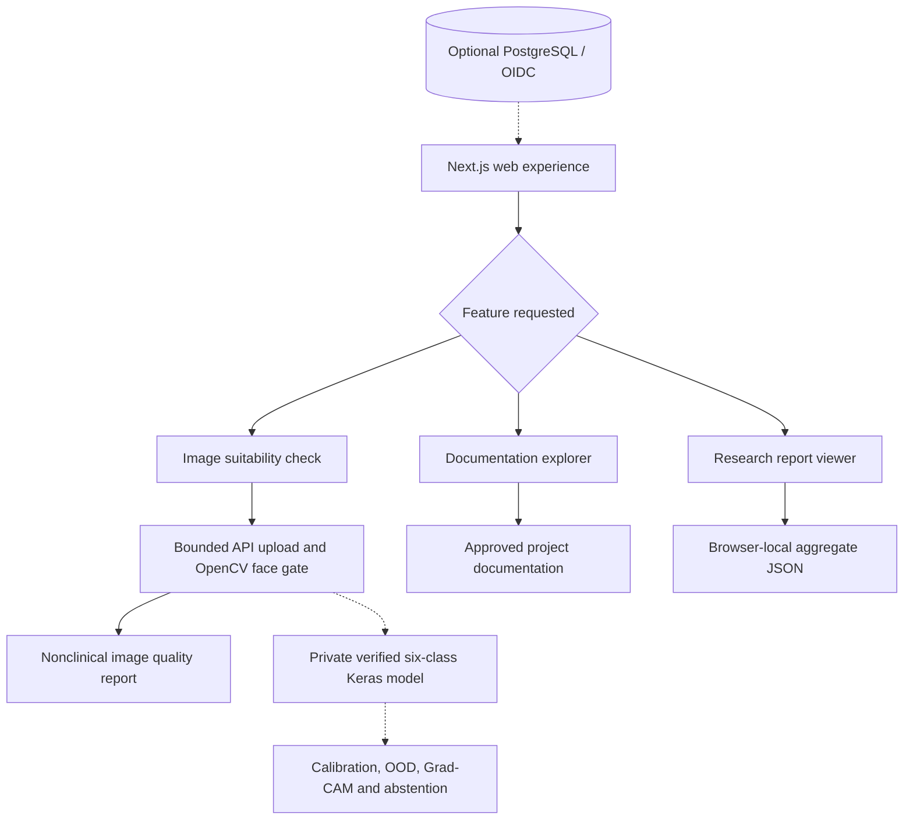

# DermaLens AI
### A full-stack engineering platform for facial skin-condition research

**Next.js · FastAPI · OpenCV · TensorFlow/Keras · PostgreSQL · Docker · CI/CD**

[](https://github.com/shanmukhdatta/DermaLens-AI/actions/workflows/phase1.yml)
[](https://github.com/shanmukhdatta/DermaLens-AI/actions/workflows/phase0.yml)

**[Explore the code](https://github.com/shanmukhdatta/DermaLens-AI)** · **[Research source](https://github.com/shanmukhdatta/Facial_Skin_Diesease)** · **[System architecture](docs/01_SYSTEM_ARCHITECTURE.md)** · **[Development tracker](GEMINI.md)**

> **Current release: engineering showcase, not a medical diagnostic service.** The Next.js application, API foundation, image-quality processing, research utilities, tests and deployment configurations are implemented. **A real trained six-class checkpoint is not connected to the public app.** No diagnostic predictions, clinical accuracy claims or skin-cancer screening results are provided.
>
> **Live demo:** To be added after Vercel deployment and real-browser verification.

## The idea

Building an image classifier is only part of building a usable AI system. **DermaLens AI** explores everything around the model: safe image uploads, detecting whether a face is present, reproducible preprocessing, model versioning, explainability research, uncertainty handling, secure accounts, documentation retrieval and deployment.

The goal is to turn a standalone facial skin research workflow into a **modular, testable full-stack application** with clear boundaries between what works today and what must be independently validated.

### What problem are we solving?

A facial image model cannot be treated as reliable simply because it outputs a class and a probability. Images may be blurry, contain multiple people, be from unfamiliar devices, or differ from training data. DermaLens is designed to **check inputs, track model provenance, measure uncertainty, and fail safely** rather than silently produce confident-looking medical answers.

## What you can explore

| Capability | What we built | Availability |
| --- | --- | --- |
| **Web experience** | Responsive white-and-green Next.js interface with project introduction, architecture, research, privacy, image-check and documentation pages | Implemented; public browser deployment not yet verified |
| **Image quality gateway** | JPEG/PNG/WebP file checks, bounded decoding, blur/brightness signals and a one-face OpenCV detection gate | Works when FastAPI backend is configured; **no disease prediction** |
| **Research categories** | Six-label project scope with clear model limitations | Informational only |
| **Research reports** | Browser-local viewer for non-identifying aggregate evaluation JSON | Implemented; no clinical metric is bundled or invented |
| **Model engineering** | Keras adapter, SHA256 model manifest, label-map validation and original predictor parity scripts | Source implemented; **trained model and real parity evidence pending** |
| **Explainability & reliability** | Offline Grad-CAM, calibration, drift and evaluation utilities | Requires real checkpoints and independent assessment |
| **Accounts & feedback** | OIDC authentication interfaces, consent, owner-scoped history, encrypted research metadata, moderated feedback | Source implemented; live identity-provider and browser E2E pending |
| **Documentation assistant** | Cited, approved-document lexical search; optional protected Grok adapter | Search needs API; semantic vector retrieval is future integration |
| **Operations & deployment** | GitHub Actions, Docker, database migrations, optional API hosting blueprint and Vercel deployment guide | CI-tested foundations; live-host verification pending |

The public demo must **never substitute simulated predictions** when the model or backend is unavailable. The app shows a clear unavailable state instead.

## Research scope: six categories

| Class | Research focus |
| --- | --- |
| Acne | Image classification of acne-like facial findings |
| Fungal Infection | Facial fungal-condition research category |
| Hyperpigmentation | Facial pigmentation-related conditions |
| Normal Skin | Research reference class, **not a medical all-clear** |
| Skin Cancer | Research label only; **not a cancer detection or screening service** |
| Vitiligo | Depigmentation-related image classification research |

These are **target classes defined by the research project**, not currently available medical assessments. Subtype recognition, lesion localization and severity grading are not validated application outputs.

The original machine-learning experiments, scripts, notebooks, data-processing modules and generation code are available in a [separate MIT-licensed research source snapshot](research/README.md) under `research/legacy/`. Large datasets, private face photographs and trained weights are deliberately not included.

## How the system is designed



**Solid arrows:** implemented paths that can operate when required services are configured. **Dashed arrows:** private/integration paths not enabled for public inference.

The intended research model input contract is **RGB → PIL bilinear resize to 224 × 224 → float32 pixels in [0, 255] → model-internal preprocessing**. The model adapter verifies a private checkpoint and the exact six-class label order. Experimental facial ROI cropping is **not** automatically applied because changing the input distribution may reduce accuracy.

### Why these components?

- **OpenCV + Pillow:** Decode images within limits, estimate visual quality and detect a single face before doing anything model-related.
- **FastAPI:** Expose versioned endpoints with typed validation, fail-closed behavior and optional ownership/security checks.
- **TensorFlow/Keras adapter:** Load only authorized, checksum-verified candidate model artifacts and preserve training-time preprocessing.
- **Grad-CAM, calibration and OOD research:** Investigate influential image regions and when a model should abstain; these require validation before use.
- **RAG/documentation search:** Explain the system from approved project documents. It does not diagnose a user's skin.
- **Next.js:** Provide a clear and accessible research showcase with honest availability and error states.
- **PostgreSQL + OIDC:** Optional authenticated, consent-based research history and feedback. Never needed for viewing the public project pages.

Read the [full architecture](docs/01_SYSTEM_ARCHITECTURE.md), [computer-vision contract](docs/02_COMPUTER_VISION_PIPELINE.md), [API design](docs/08_API_AND_DATA_FLOW.md), [privacy model](docs/09_PRIVACY_AND_SAFETY.md) and [decision records](docs/adr/README.md) for implementation details.

## Technology stack

| Layer | Tools |
| --- | --- |
| Frontend | Next.js 16, React 19, TypeScript, accessible responsive CSS |
| Backend | Python 3.11, FastAPI, Pydantic, typed service interfaces |
| Computer vision | OpenCV, Pillow; candidate TensorFlow/Keras integration |
| Data & authentication | SQLAlchemy, Alembic, PostgreSQL, OIDC/JWKS, encrypted nonclinical result metadata |
| Research & MLOps | Model manifests, SHA256, evaluation, duplicate auditing, Grad-CAM/calibration research, drift-review scripts |
| Developer experience | pytest, Vitest, Ruff, mypy, TypeScript, GitHub Actions |
| Deployment | Vercel (web), container host for FastAPI, Docker Compose for local integration |

## Repository structure

```text
DermaLens-AI/
├── apps/
│   ├── web/                  Next.js frontend and same-origin API proxies
│   └── api/                  FastAPI application, routes and middleware
├── services/
│   ├── cv/                   Image validation, face detection, model runtime, Grad-CAM
│   ├── learning/             Evaluation, calibration, feedback and drift
│   ├── persistence/          Database, encryption, ownership and retention
│   └── rag/                  Approved-document search and optional LLM provider
├── packages/                 Shared security, telemetry and API contracts
├── models/manifests/         Model artifact schema (NO weights)
├── research/legacy/          Original research source and notebooks, isolated from serving
├── scripts/                  Model parity, evaluation, audits and operational checks
├── infra/docker/             API and web container files
├── docs/                     Architecture, ADRs and detailed deployment/runbook guides
├── tests/                    Backend and system tests
├── render.yaml               Optional API deployment blueprint
├── GEMINI.md                 Persistent task tracker / Antigravity handoff
└── README.md                 You are here
```

## Run it locally

**Requirements:** Python 3.11, [uv](https://docs.astral.sh/uv/), Node.js 22+ and npm. Docker is optional.

### Frontend-only preview

```bash
git clone https://github.com/shanmukhdatta/DermaLens-AI.git
cd DermaLens-AI/apps/web
npm ci
npm run dev
```

Open **http://localhost:3000**. Public informational pages work without a backend. Upload and documentation-search requests show an honest unavailable response until the API is configured.

### Enable nonclinical image checks

From a separate terminal in the repository root:

```bash
uv sync --python 3.11 --frozen --all-groups
uv pip install --python .venv/bin/python -r requirements-cv.txt -r requirements-persistence.txt -r requirements-rag.txt
DERMALENS_ENABLE_IMAGE_QUALITY_CHECKS=true uv run --frozen --no-sync uvicorn apps.api.dermalens_api.main:app --host 127.0.0.1 --port 8000
```

For **Windows PowerShell**, install into `.venv\Scripts\python.exe` and set `$env:DERMALENS_ENABLE_IMAGE_QUALITY_CHECKS="true"` before the `uv run` command.

The frontend proxies image checking and document search to the local API by default. **This is an image suitability workflow, not a skin disease prediction.**

### Optional local Docker stack

```bash
# Create an untracked .env with DERMALENS_POSTGRES_PASSWORD=<strong-local-password>
docker compose config -q
docker compose up --build -d --wait
docker compose down
```

Do not expose the local Docker Compose stack as a public medical service or run `docker compose down --volumes` unless intentionally deleting local data.

## Verification

```bash
uv run --frozen --no-sync ruff check .
uv run --frozen --no-sync mypy apps packages services
uv run --frozen --no-sync python -m pytest -q
uv run --frozen --no-sync python -m scripts.validate_phase0

cd apps/web
npm ci
npm run lint
npm run typecheck
npm test
npm run build
```

**Recorded automated evidence:** the October 25, 2026 recruiter-showcase update [PR #37](https://github.com/shanmukhdatta/DermaLens-AI/pull/37) passed **133 Python tests and 17 frontend tests**, plus frontend build, static checks and Docker staging smoke. These are engineering checks, **not** claims of real-model accuracy, manual browser acceptance or clinical safety. Consult [GitHub Actions](https://github.com/shanmukhdatta/DermaLens-AI/actions) for current checks.

## Deployment

The public recruiter showcase and the Python backend are **separate deployments**:

| Component | Recommended host | Required configuration |
| --- | --- | --- |
| Web frontend | Vercel | Import repo; **Root Directory = `apps/web`**, Next.js, Node.js 22+ |
| Optional image-check & docs API | Render or equivalent Docker host | `render.yaml`, correct HTTPS web origin and explicitly enabled nonclinical image checks |
| Web-to-API connection | Server-side Vercel environment | `DERMALENS_WEB_API_BASE_URL=https://<actual-api-host>` |
| Trained research classifier | Not deployed in public version | Authorized private artifacts, exact label map, verified model parity and independent validation |

A frontend-only deployment is valid: it showcases the architecture and UI while displaying that API-dependent features are unavailable. When the API is hosted, image quality and documentation search can run without enabling a medical model.

See the complete [Vercel + API deployment guide](docs/RECRUITER_DEPLOYMENT.md) for prerequisites, environment variables, security checks and rollback.

## Current progress & next milestones

**Completed as source/CI milestones:** the modular application, Next.js experience, FastAPI foundations, nonclinical image processing, documented research source, evaluation utilities, GitHub workflows and container configuration.

**Next for the recruiter demo:** independently test the website in a real desktop/mobile browser, deploy the frontend to Vercel, optionally deploy FastAPI for actual image quality checks, then add a verified live URL and screenshots.

**Next for private research integration:** obtain the genuine authorized `.keras` checkpoint, exact `label_map.json`, run [predictor parity verification](docs/MODEL_ARTIFACT_PARITY_RUNBOOK.md), test real independent images, calibrate uncertainty, review Grad-CAM, and complete the protected research workflow. Real identity-provider integration, semantic vector RAG and operational monitoring also remain to be verified.

**Later / optional:** severity grading, segmentation, controlled retraining and reinforcement learning; none is a condition for the initial public engineering showcase.

**Want to resume development?** Open **[GEMINI.md](GEMINI.md)**. It tracks completed work, unresolved blockers, next tasks, acceptance evidence, local commands and a session-by-session handoff. The [phase tracker](docs/PHASE_TRACKER.md) and [gap audit](docs/FINAL_GAP_CLOSURE_CHECKLIST.md) contain additional technical detail.

## Responsible use & license

DermaLens AI is an **engineering research prototype**, not a medical device or clinical diagnostic service. Do not rely on its quality checks or future research predictions to diagnose, treat, exclude or grade conditions. A Grad-CAM highlight is not a diagnosis. Handle all facial photographs with permission, and keep patient images, private datasets, model weights and credentials outside public GitHub history.

Platform source: [MIT license](LICENSE). Imported original research source retains its [MIT license and attribution](research/legacy/LICENSE).

---

**Engineering focus:** reproducibility, privacy-conscious design, transparent AI limitations and modular full-stack delivery.
