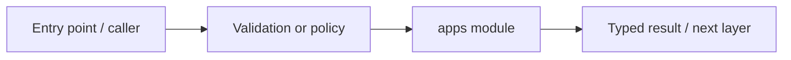

# apps — module technical guide

## Purpose and scope

Full-stack application entrypoints. Status: **Production model readiness remains disabled**. See root README and `docs/FINAL_FEATURE_AUDIT.md` for the release state.

## Direct file index

- `__init__.py` — Python module / executable logic

## Architecture and internal workflow

Frontend -> bounded API -> service modules.



## Public interfaces and integration

Next.js UI and FastAPI public API. Consumers should use these boundaries rather than bypassing permissions, model integrity checks or consent.

## Dependencies and configuration

See apps/web and apps/api configuration. Do not commit secrets, patient photographs, model checkpoints or other sensitive artifacts.

## Verification

Run from repository root unless the command is an npm script (run npm scripts from `apps/web`):

```bash
Backend pytest and npm test/build
```

These are **recommended commands**, not a claim they were executed during this documentation change. Record commit SHA, test output and independent integration evidence before changing audit state.
