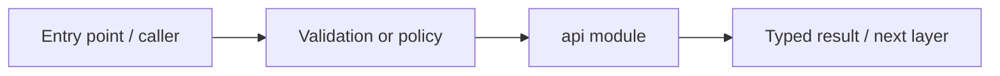

# apps/api — module technical guide

## Purpose and scope

HTTP service code and FastAPI project package. Status: **Quality-check and documentation APIs; clinical analysis not exposed**. See root README and `docs/FINAL_FEATURE_AUDIT.md` for the release state.

## Direct file index

- `__init__.py` — Python module / executable logic

## Architecture and internal workflow

FastAPI route -> auth/validation -> service -> safe response.



## Public interfaces and integration

apps.api.dermalens_api.main:create_app. Consumers should use these boundaries rather than bypassing permissions, model integrity checks or consent.

## Dependencies and configuration

DERMALENS_* variables defined in config.py. Do not commit secrets, patient photographs, model checkpoints or other sensitive artifacts.

## Verification

Run from repository root unless the command is an npm script (run npm scripts from `apps/web`):

```bash
python -m pytest -q tests/test_phase2_backend.py
```

These are **recommended commands**, not a claim they were executed during this documentation change. Record commit SHA, test output and independent integration evidence before changing audit state.
