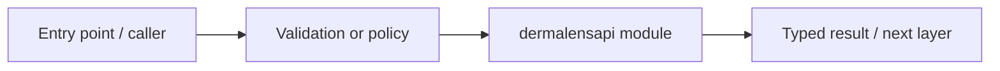

# apps/api/dermalens_api — module technical guide

## Purpose and scope

FastAPI composition, configuration, dependencies and readiness. Status: **Fail closed; no verified public medical prediction endpoint**. See root README and `docs/FINAL_FEATURE_AUDIT.md` for the release state.

## Direct file index

- `__init__.py` — Python module / executable logic
- `config.py` — Python module / executable logic
- `dependencies.py` — Python module / executable logic
- `main.py` — Python module / executable logic
- `middleware.py` — Python module / executable logic
- `readiness.py` — Python module / executable logic

## Architecture and internal workflow

Middleware -> route -> service -> bounded JSON.



## Public interfaces and integration

main.create_app, dependencies.require_verified_actor, readiness.ReadinessGates. Consumers should use these boundaries rather than bypassing permissions, model integrity checks or consent.

## Dependencies and configuration

DERMALENS_DATABASE_URL, OIDC configuration and explicit feature flags. Do not commit secrets, patient photographs, model checkpoints or other sensitive artifacts.

## Verification

Run from repository root unless the command is an npm script (run npm scripts from `apps/web`):

```bash
python -m pytest -q tests/test_api_foundation.py tests/test_phase2_backend.py
```

These are **recommended commands**, not a claim they were executed during this documentation change. Record commit SHA, test output and independent integration evidence before changing audit state.
