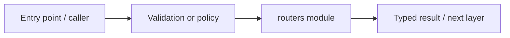

# apps/api/dermalens_api/routers — module technical guide

## Purpose and scope

Versioned HTTP route handlers and request schemas. Status: **Image suitability only, not diagnosis**. See root README and `docs/FINAL_FEATURE_AUDIT.md` for the release state.

## Direct file index

- `__init__.py` — Python module / executable logic
- `account.py` — Python module / executable logic
- `copilot.py` — Python module / executable logic
- `docs_search.py` — Python module / executable logic
- `feedback.py` — Python module / executable logic
- `images.py` — Python module / executable logic
- `models.py` — Python module / executable logic
- `operations.py` — Python module / executable logic

## Architecture and internal workflow

Request -> validation -> identity if protected -> service -> redacted response.



## Public interfaces and integration

/health, /readiness, /models/current, /images/check, /docs/search, /account, /analyses/{id}/feedback; optional copilot. Consumers should use these boundaries rather than bypassing permissions, model integrity checks or consent.

## Dependencies and configuration

Enable optional gates only after credentials and independent verification. Do not commit secrets, patient photographs, model checkpoints or other sensitive artifacts.

## Verification

Run from repository root unless the command is an npm script (run npm scripts from `apps/web`):

```bash
python -m pytest -q tests/test_phase2_backend.py tests/test_integration_docs_search.py
```

These are **recommended commands**, not a claim they were executed during this documentation change. Record commit SHA, test output and independent integration evidence before changing audit state.
