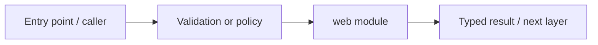

# apps/web — module technical guide

## Purpose and scope

Next.js application, lockfile and frontend tooling. Status: **Warm orange-and-white research UX; no live sign-in/diagnosis**. See root README and `docs/FINAL_FEATURE_AUDIT.md` for the release state.

## Direct file index

- `.env.example` — module source or configuration
- `.gitignore` — module source or configuration
- `eslint.config.mjs` — module source or configuration
- `next-env.d.ts` — module source or configuration
- `next.config.ts` — module source or configuration
- `package-lock.json` — validated machine-readable configuration
- `package.json` — validated machine-readable configuration
- `tsconfig.json` — validated machine-readable configuration

## Architecture and internal workflow

Page -> typed browser API -> bounded backend response.



## Public interfaces and integration

App Router via src/app; npm run dev/build/test/typecheck/lint. Consumers should use these boundaries rather than bypassing permissions, model integrity checks or consent.

## Dependencies and configuration

NEXT_PUBLIC_API_BASE_URL in apps/web/.env.example. Do not commit secrets, patient photographs, model checkpoints or other sensitive artifacts.

## Verification

Run from repository root unless the command is an npm script (run npm scripts from `apps/web`):

```bash
npm ci && npm run lint && npm test && npm run typecheck && npm run build
```

These are **recommended commands**, not a claim they were executed during this documentation change. Record commit SHA, test output and independent integration evidence before changing audit state.
