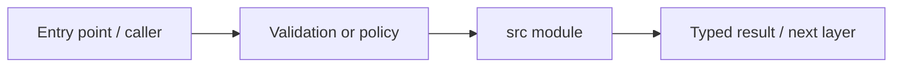

# apps/web/src — module technical guide

## Purpose and scope

Client source files grouped into routes, reusable components and request adapters. Status: **No credential handling in public browser bundles**. See root README and `docs/FINAL_FEATURE_AUDIT.md` for the release state.

## Direct file index

- This folder mainly groups nested packages; consult child README files.

## Architecture and internal workflow

UI route -> component -> client adapter -> FastAPI.



## Public interfaces and integration

app routes, components, lib. Consumers should use these boundaries rather than bypassing permissions, model integrity checks or consent.

## Dependencies and configuration

Next.js TypeScript aliases via tsconfig.json. Do not commit secrets, patient photographs, model checkpoints or other sensitive artifacts.

## Verification

Run from repository root unless the command is an npm script (run npm scripts from `apps/web`):

```bash
npm test && npm run build
```

These are **recommended commands**, not a claim they were executed during this documentation change. Record commit SHA, test output and independent integration evidence before changing audit state.
