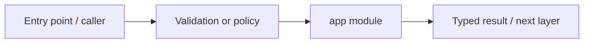

# apps/web/src/app — module technical guide

## Purpose and scope

Next.js App Router screens and root layout. Status: **History intentionally unavailable without verified identity**. See root README and `docs/FINAL_FEATURE_AUDIT.md` for the release state.

## Direct file index

- `globals.css` — design and responsive styling
- `layout.tsx` — React/Next.js component
- `page.tsx` — React/Next.js component

## Architecture and internal workflow

Route -> client component -> typed service/controlled states.



## Public interfaces and integration

/, /check, /how-it-works, /privacy, /assistant, /research, /history. Consumers should use these boundaries rather than bypassing permissions, model integrity checks or consent.

## Dependencies and configuration

globals.css design tokens, RootLayout. Do not commit secrets, patient photographs, model checkpoints or other sensitive artifacts.

## Verification

Run from repository root unless the command is an npm script (run npm scripts from `apps/web`):

```bash
npm run lint && npm run build
```

These are **recommended commands**, not a claim they were executed during this documentation change. Record commit SHA, test output and independent integration evidence before changing audit state.
