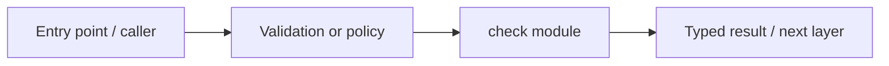

# apps/web/src/app/check — module technical guide

## Purpose and scope

Non-diagnostic photo suitability screen. Status: **No medical prediction shown, raw file is not persisted**. See root README and `docs/FINAL_FEATURE_AUDIT.md` for the release state.

## Direct file index

- `page.tsx` — React/Next.js component

## Architecture and internal workflow

File choice -> size/type validation -> user notice -> upload -> suitability feedback.



## Public interfaces and integration

default export CheckPage. Consumers should use these boundaries rather than bypassing permissions, model integrity checks or consent.

## Dependencies and configuration

NEXT_PUBLIC_API_BASE_URL; image quality server gate. Do not commit secrets, patient photographs, model checkpoints or other sensitive artifacts.

## Verification

Run from repository root unless the command is an npm script (run npm scripts from `apps/web`):

```bash
npm run build; manual invalid/large/corrupt image tests
```

These are **recommended commands**, not a claim they were executed during this documentation change. Record commit SHA, test output and independent integration evidence before changing audit state.
