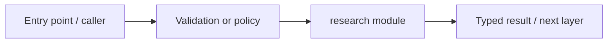

# apps/web/src/app/research — module technical guide

## Purpose and scope

Client-only aggregate evaluation viewer. Status: **Report display is not clinical validation**. See root README and `docs/FINAL_FEATURE_AUDIT.md` for the release state.

## Direct file index

- `page.tsx` — React/Next.js component

## Architecture and internal workflow

Local JSON select -> schema validation -> aggregate statistics table.



## Public interfaces and integration

default export ResearchPage; lib/research-evaluation.ts. Consumers should use these boundaries rather than bypassing permissions, model integrity checks or consent.

## Dependencies and configuration

No server uploads; do not enter identifiable records. Do not commit secrets, patient photographs, model checkpoints or other sensitive artifacts.

## Verification

Run from repository root unless the command is an npm script (run npm scripts from `apps/web`):

```bash
npm test && npm run build
```

These are **recommended commands**, not a claim they were executed during this documentation change. Record commit SHA, test output and independent integration evidence before changing audit state.
