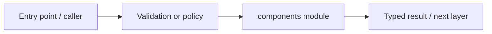

# apps/web/src/components — module technical guide

## Purpose and scope

Reusable navigation and footer components. Status: **Keyboard navigation, active route, accessible skip-link**. See root README and `docs/FINAL_FEATURE_AUDIT.md` for the release state.

## Direct file index

- `site-footer.tsx` — React/Next.js component
- `site-header.tsx` — React/Next.js component

## Architecture and internal workflow

Layout -> navigation -> route components.



## Public interfaces and integration

SiteHeader, SiteFooter. Consumers should use these boundaries rather than bypassing permissions, model integrity checks or consent.

## Dependencies and configuration

Global design tokens in app/globals.css. Do not commit secrets, patient photographs, model checkpoints or other sensitive artifacts.

## Verification

Run from repository root unless the command is an npm script (run npm scripts from `apps/web`):

```bash
npm run lint && npm run build
```

These are **recommended commands**, not a claim they were executed during this documentation change. Record commit SHA, test output and independent integration evidence before changing audit state.
