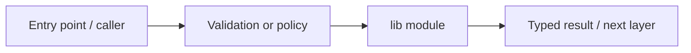

# apps/web/src/lib — module technical guide

## Purpose and scope

Browser request adapters, typed results, parsers and unit tests. Status: **No fake probabilities or medical claims**. See root README and `docs/FINAL_FEATURE_AUDIT.md` for the release state.

## Direct file index

- `docs-api.test.ts` — automated checks
- `docs-api.ts` — module source or configuration
- `image-api.test.ts` — automated checks
- `image-api.ts` — module source or configuration
- `platform-status.test.ts` — automated checks
- `platform-status.ts` — module source or configuration
- `research-evaluation.test.ts` — automated checks
- `research-evaluation.ts` — module source or configuration

## Architecture and internal workflow

Input validation -> typed API call / local parse -> view state.



## Public interfaces and integration

image-api, docs-api, research-evaluation, platform-status. Consumers should use these boundaries rather than bypassing permissions, model integrity checks or consent.

## Dependencies and configuration

NEXT_PUBLIC_API_BASE_URL; no embedded secrets. Do not commit secrets, patient photographs, model checkpoints or other sensitive artifacts.

## Verification

Run from repository root unless the command is an npm script (run npm scripts from `apps/web`):

```bash
npm test && npm run typecheck
```

These are **recommended commands**, not a claim they were executed during this documentation change. Record commit SHA, test output and independent integration evidence before changing audit state.
