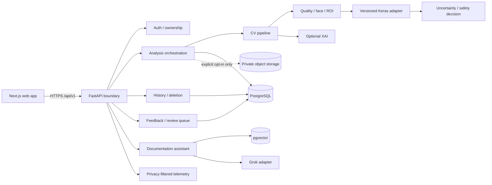
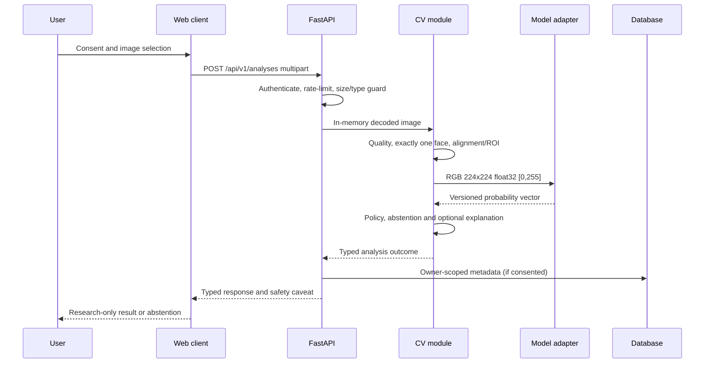

# System architecture — decision baseline (Phase 0)

**Status:** designed, not implemented. Source of requirements: root README; execution order: [phase tracker](PHASE_TRACKER.md). This documentation describes target contracts, not verified working functionality.

## Boundaries and ownership

A modular monolith: one FastAPI deployment runs the API, use-case orchestration, CV pipeline, model adapter, persistence, feedback and curated-document RAG behind separate Python modules. Next.js is a separate web client deployment; PostgreSQL with pgvector is the primary database. S3-compatible object storage is optional and off by default for raw faces. Grok is accessed by server-only outbound requests and only for the documentation assistant.

## Image analysis sequence

## Service interfaces (in-process, no HTTP between internal modules)

- `AnalysisService.analyze(image_bytes, actor, consent, request_id) -> AnalysisOutcome`: guarantees admission checks and cleanup; no raw bytes passed to feedback or RAG.
- `CVPipeline.evaluate(image_bytes, model: ModelRuntime) -> CVOutcome`: stage outcomes (`rejected`, `abstained`, `completed`) with reason codes; its model-specific behavior is not duplicated in API.
- `ModelRuntime.load(verified_manifest, label_map) / predict(batch) -> RawPrediction`: gate on integrity, shape, and output validity. Missing artifact causes `MODEL_NOT_READY`, not silent mocks.
- `AnalysisRepository`, `FeedbackRepository`, `DocumentIndex`, `LLMProvider`, and `PrivateObjectStore` are constructor-injected ports; adapters live at module edge.
- `SafetyDecision.evaluate(quality, raw_prediction, calibration, ood) -> decision`: fail-closed if a required calibrated policy is absent, supports abstention.
- `RAGAssistant.answer(question, actor) -> AnswerWithCitations`: curated markdown ONLY, no medical diagnosis, no image access, no mutation of analysis.

Internal contracts are Python typed dataclasses / Pydantic models, versioned with API schemas. No request to Grok includes image pixels or personalized analysis/history. The RAG index uses approved public-facing docs, not runtime secrets, raw medical data, or system logs.

## Versioning and gates

Every output records `model_id`, `model_version`, `manifest_sha256`, `label_map_sha256`, `preprocessing_version`, `pipeline_version`. API version: `/api/v1`. Schemas are additive within v1; breaking changes require /v2. Artifact promotion is separate from code release; the system refuses to load unverified, unapproved artifacts. Documentation decisions do not imply clinical safety.

See [CV](02_COMPUTER_VISION_PIPELINE.md), [model provenance](03_MODEL_AND_RESEARCH.md), [backend](04_BACKEND_ARCHITECTURE.md), [RAG](05_RAG_ASSISTANT.md), [feedback](06_FEEDBACK_AND_CONTINUAL_LEARNING.md), [ops](07_MLOPS_AND_DEPLOYMENT.md), [API](08_API_AND_DATA_FLOW.md), [privacy](09_PRIVACY_AND_SAFETY.md).
