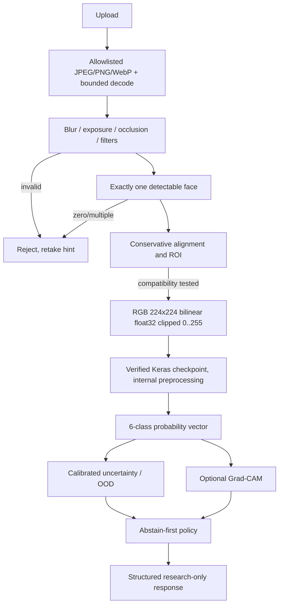

# Computer vision pipeline — contract (planned)

**Ground truth of compatibility:** the research `src/inference/predictor.py` does `PIL.Image.convert("RGB").resize((224,224), PIL.Image.BILINEAR)` then NumPy float32, clips to [0,255], adds a batch axis, and calls `model.predict`. Do not normalize twice. EXIF orientation, crop/ROI and face alignment can change training distribution; evaluate equivalence and documented deviations before enabling them for a registered model. Security boundary: decode only after compressed-byte size guard, enforce pixel and frame limits, reject decompression bombs/animated and pathological files; strip metadata and avoid copying raw image into logs.

**Model outputs:** only one of six top-level categories when and only when the verified artifact declares this head; no severity/subtype prediction. "Skin Cancer" is a research class label, not a finding of cancer or a screening clearance. No "Normal Skin" clinical reassurance.

**Image-quality, uncertainty, OOD, explainability:** thresholds MUST come from held-out/real-world calibration/evaluation, never invented. Until proven, return `abstained` / `POLICY_NOT_VALIDATED`. Quality failure is a user-recapture path. A Grad-CAM map, when available, indicates model attention, not lesion localization/diagnosis; on unsupported architectures return `available: false` with reason.

**Testing strategy:** golden image decode parity against original research script; input color/shape/value assertions; six-output ordering from exact label map; invalid/corrupt/multi-face/filtered tests; synthetic-to-real stratified validation and subgroup errors. Do not upload face fixtures to public Git without consent and rights.
