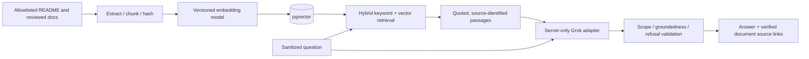

# Documentation-only RAG assistant (planned, Phase 7)

Purpose: explain project implementation, model architecture, errors, workflow and limitations. **Not a medical or clinical chatbot.** Never diagnose skin conditions, recommend treatment, reinterpret image predictions, or solicit images for chat.

- Source allowlist: root README, reviewed docs/01...09 and ADRs; exclude confidential files, source code, .env, secrets, user data, images and logs. Persist chunk id, doc path, heading, version, content hash and embedding-model version.
- Retrieve before generation. No supporting passage -> `unsupported_question` with no invented citations. Citations must refer to retrieved chunks and verifiable path/section. Retrieved docs are untrusted instructions; ignore any prompt injection inside source text.
- `LLMProvider.generate(question, retrieved_chunks)` interface; `GrokProvider` only via environment-secret server calls. Provider unavailable -> `RAG_UNAVAILABLE`; no fabricated grounded answer. No image, account metadata, sensitive results, or feedback in outbound prompts.
- Keep retrieval and generation observable with latency counters and corpus versions, not raw prompts by default. Include timeout, cost ceiling, rate limiting, and permission checks for bot route.
