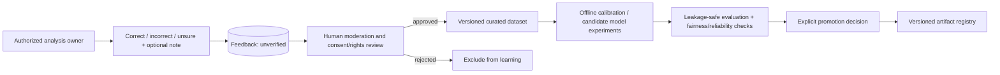

# Feedback, review, controlled improvement (planned)

`feedback.status` transitions: `submitted -> under_review -> validated | rejected`; `validated` requires authorized review/audit evidence. Feedback is not a training label until human-validated with necessary consent and rights. Store feedback separately from inference, preserve original model version, enforce owner authorization and abuse prevention. Provide deletion/withdrawal path; ensure revoked research-consent images are removed from future training builds where feasible.

**No online weight updates.** Offline model experiments, hard-example curation, optional auxiliary models and RL decision-policy research are gated by evidence, proper evaluation, and an explicit scope decision. Original classifier remains immutable between approved version promotions. Phase 13 adds improvement mechanisms; no experiments begin in Phase 0.
