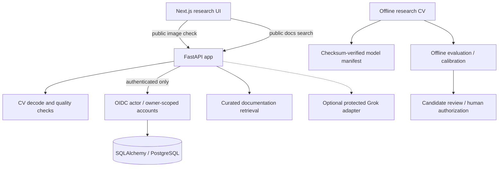

# DermaLens AI — Architecture (as implemented)

The primary specifications remain the root README and `docs/01_SYSTEM_ARCHITECTURE.md` through `docs/09_PRIVACY_AND_SAFETY.md`. This document is a short, code-grounded entrypoint, not a substitute for their more complete designs.

No arrow from the public upload endpoint to the offline CV runtime is intentional. Quality checks are not diagnoses. `services/cv/offline_pipeline.py` is offline-only and abstains until trusted artifact and calibration gates are met. Feedback cannot silently trigger training or automatic deployment.

## Operational boundaries

- `apps/web`: interface and public request adapters. Warm design tokens in `src/app/globals.css`.
- `apps/api`: route composition, security middleware, fail-closed readiness.
- `services`: quality/CV, RAG, owner-scoped persistence and offline learning policy.
- `packages`: reusable contracts, security primitives, error and telemetry functions.
- `infra`: Docker configuration and Alembic database migration infrastructure.
- `scripts`: offline auditing and operational CLI entrypoints.

Use `docs/FINAL_ENGINEERING_HANDOFF.md` for reproducible checks and explicit blockers.

## Expiry maintenance boundary

`scripts/prune_expired_history.py` is an offline operator entrypoint into `services/persistence/retention.py`. It is not registered with FastAPI or an automatic scheduler. A per-batch transaction removes expired metadata and its cascaded feedback while respecting non-expiring entries. Review `docs/RETENTION_OPERATIONS.md` before enabling any recurring production task.
