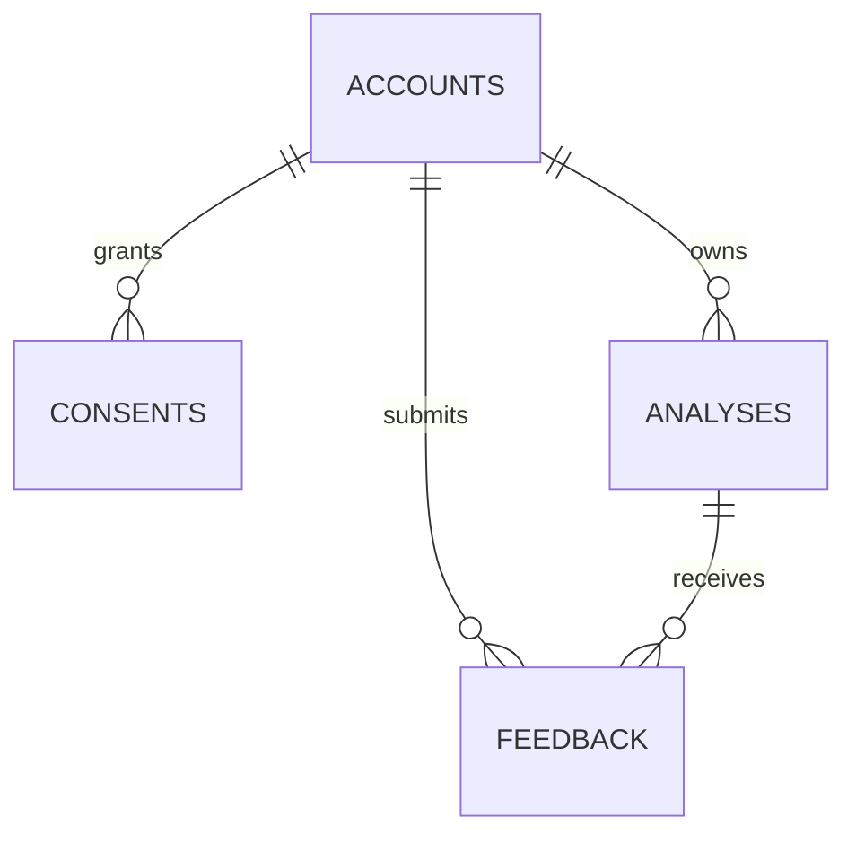

# DermaLens AI — Database design (current state)

Source of truth: `services/persistence/models.py` and `infra/database/migrations/versions/`. PostgreSQL is required in staging/production; SQLite is allowed only for local tests.

| Table | Key fields | Enforcement |
|---|---|---|
| `accounts` | UUID ID, issuer, subject, created_at | Unique provider issuer + subject; never trust client-supplied actor ID |
| `consents` | account_id, purpose, granted, updated_at | One account/purpose pair; revocation purges history metadata |
| `analyses` | account_id, status, model_version, pipeline_version, created_at, expires_at | Reserved for verified analysis metadata; no public create endpoint |
| `feedback` | account_id, analysis_id, choice, review_status, created_at | Unique feedback per actor and analysis; review pending by default |

Transactions and actor-scoped reads live in `services/persistence/repository.py`. Use Alembic migrations rather than creating production tables ad hoc. Raw facial photographs are **not** persisted by the current application. Encryption-at-rest, live retention jobs and auditable object storage remain release blockers, not implemented database claims.

## Offline expiration cleanup

Revision `0003_expiry` indexes `analyses.expires_at`. An operator may call `python -m scripts.prune_expired_history` (dry-run default), or add `--execute --confirm-delete` after review to remove one bounded batch of expired analysis metadata with dependent feedback. No recurring retention scheduler or encrypted image-store deletion is implemented. See `docs/RETENTION_OPERATIONS.md`.
