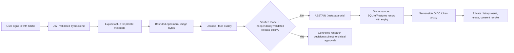

# DermaLens — gap-closure acceptance checklist (PR #30, 2026-10-22)

Source: latest main after PR #27 (`dcde5699c735addd39db76a0f15158e6dcab17ec`), root README §§4–51 and prior `FINAL_FEATURE_AUDIT.md`. **A tested route is not proof of clinical validity.** State changes below are specific to this implementation branch; recheck the exact commit's GitHub CI for execution status.

| ID | Gap / acceptance | Source code | State | Required evidence |
|---|---|---|---|---|
| A01 | Preserve exact six-class label order | `services/cv/artifacts.py` | Existing | Checkpoint, producer-run label_map.json and SHA256 |
| A02 | Exact 224×224 RGB float32 [0,255] preprocessing | `services/cv/artifacts.py`; `keras_runtime.py` | Existing | Matched real research predictor parity fixtures |
| A03 | Reject mismatched checkpoint SHA/serialized custom objects | `services/cv/keras_runtime.py` | Existing | Signed rights-cleared .keras export |
| A04 | Start real runtime only when all three artifact paths supplied | `apps/api/dermalens_api/main.py`; `config.py` | **Code added** | Actual compatible real checkpoint smoke |
| A05 | Refuse prediction without policy + independent evaluation | `services/cv/offline_pipeline.py`; `readiness.py` | Existing, intentional abstention | Independent heldout and human release sign-off |
| B01 | Source/content hash and subject-split leakage check | `services/learning/evaluation.py` | Existing | Real appropriate licensed clinical image population |
| B02 | Per-class metrics, Brier, NLL, ECE and subgroups | `services/learning/evaluation.py` | Existing | Fixed real-patient test manifest, approved provenance |
| B03 | Cross-split near-duplicate/perceptual audit | `services/learning/duplicate_audit.py` | Planned in branch | Human-reviewed suspicious pair threshold study |
| B04 | Clinical utility / safe OOD across actual deployment populations | `docs/03_MODEL_AND_RESEARCH.md` | **External evidence blocked** | Independent ethically sourced cohort and human clinical review |
| C01 | Verified OIDC bearer required on upload | `routers/analyses.py` | **Code added** | Auth boundary API test and real OIDC test |
| C02 | Explicit consent before any metadata storage | `routers/analyses.py`; `repository.py` | **Code added** | Declined-consent and revocation tests |
| C03 | Strict MIME/byte validation and no raw image persistence | `routers/analyses.py`; `services/cv/quality.py` | **Code added** | Real-byte QA, oversized and invalid type rejection |
| C04 | Image suitability + abstention runtime, no mock medical class | `routers/analyses.py`; `offline_pipeline.py` | **Code added** | Verified fixture + checkpoint-gated flow |
| C05 | Owner-only stored result retrieval | `routers/analyses.py` | **Code added** | Cross-account 404 tests |
| C06 | Per-record deletion, scoped by issuer/subject | `routers/analyses.py` | **Code added** | Owner and non-owner delete tests |
| C07 | Thirty-day metadata expiry, no raw photo at rest | `services/persistence/models.py`; `retention.py` | **Code added** | Retention cleanup run + real DB migration |
| C08 | Alembic result metadata migration and nullable legacy rows | `0004_analysis_result_metadata.py` | **Code added** | SQLite migration test and Docker/PostgreSQL smoke |
| D01 | Fail-closed OIDC verification backend | `packages/security/oidc.py` | Existing | Signed JWT, audience, real IdP JWKS |
| D02 | Browser OIDC login/sign-out via maintained Auth.js | `apps/web/src/auth.ts`; `app/api/auth` | **Code added** | Build and real IdP callback test |
| D03 | Backend access tokens stay server-side in BFF | `app/api/private/[...path]/route.ts` | **Code added** | CSRF and unauthorized proxy tests |
| D04 | Protected history, consent, upload, retrieve, delete UX | `history/history-workspace.tsx` | **Code added** | Connected browser test under real OIDC |
| D05 | Self-hosted registration/password hashing | N/A | **Not adopted** | Identity provider owns registration, password storage and reset |
| E01 | TTL retention + account erasure | `services/persistence/retention.py`; `account.py` | Existing + integrated | End-to-end regulated disposal and backup erasure |
| E02 | JWT-bound authorization and privacy-safe request logs | `packages/security/oidc.py`; `middleware.py` | Existing + extended | Penetration and privacy QA |
| E03 | Analysis-rate budget and CSRF checks | `middleware.py`; `rate_limit.py`; BFF | **Code added** | Abuse/security negative controls |
| E04 | Encrypt sensitive photographs at rest | None (photos are **not stored**) | **Not applicable by design** | If future image retention is added, require independent encrypted object-store review |
| E05 | Indian data protection rules / child consent | `docs/TECHNICAL_RESEARCH_DECISIONS.md` | **Legal review blocked** | Jurisdiction-specific counsel and verifiable parental-consent flow where applicable |
| E06 | TLS, locked-down identity, deployment secrets | `compose.yaml`; `config.py` | Existing/partial | Actual HTTPS ingress and secret-service review |
| E07 | Full production security, clinical, regulatory sign-off | N/A | **Blocked** | Threat modeling, external evaluation, security/legal review |

## Critical remaining functional gaps

A *real trusted checkpoint* and exact training-run label map are absent. The API loads a manifest-verified checkpoint when explicitly configured, but **still does not publish a clinical label**, and `/readiness` stays 503 until an independently approved clinical policy is integrated. Independent clinical validation is unavailable and cannot be synthesized. No raw photos are persisted; only opt-in, non-diagnostic status/quality/reason metadata is saved.

Further work: near-duplicate audit across licensed test data, real identity provider browser callbacks, production monitoring, persistent RAG embedding retrieval, true calibrator/OOD validation, security certification and patient-subject population evaluation.

## Acceptance flow

**The technical integration is not a claim that the classifier has become medically suitable.** Each row needs exact CI, model-data or clinical verification before promotion.
