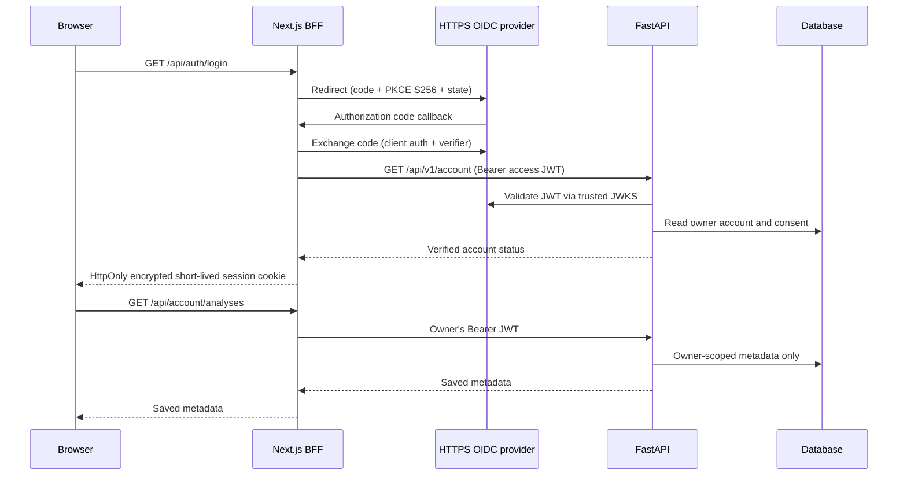

# Browser identity and saved history integration

**Status:** Code implemented for authorization code + PKCE BFF, awaiting live provider credentials, a configured API/database, browser-level testing and security review. No medical inference is activated by this integration.

## Architecture

## Implementation

- Source: `apps/web/src/lib/auth-server.ts`, `session-crypto.ts`, `src/app/api/auth/*`, `src/app/api/account/[[...action]]/route.ts`, `src/app/history/page.tsx`.
- Web variables: `DERMALENS_WEB_OIDC_ISSUER`, `DERMALENS_WEB_OIDC_CLIENT_ID`, `DERMALENS_WEB_OIDC_CLIENT_SECRET`, `DERMALENS_WEB_SESSION_KEY`, `DERMALENS_WEB_APP_ORIGIN`, `DERMALENS_WEB_API_BASE_URL`. See `apps/web/.env.example`.
- Backend must be configured with matching issuer, API audience, HTTPS JWKS and `DERMALENS_DATABASE_URL` (migrations applied). The provider **must** issue an RS256 JWT access token with intended API audience; ID tokens and opaque tokens are not accepted by FastAPI.
- Configure provider's registered callback to `APP_ORIGIN/api/auth/callback`; use HTTPS for all endpoints outside localhost.
- Only allowlisted account endpoints are forwarded. No frontend-supplied account identifier; FastAPI verifies JWT and scopes all records by issuer+subject.
- Access tokens stay server-side encrypted in AES-256-GCM authenticated cookies with Secure/HttpOnly/SameSite Strict outside local development, short TTL and no refresh tokens. No tokens in JS, localStorage, sessionStorage or query parameters. PKCE transaction cookie is encrypted, state checked in constant time and cleared at callback.
- Same-origin checks guard mutating BFF calls; logout and account deletion clear session cookies. Provider single-logout, server-side revocation, centralized session management, incident handling and distributed deployment controls require separate assessment.
- Consent opt-in and revocation reuse existing FastAPI persistence. History is metadata-only; no image or clinical prediction is newly stored.

## Acceptance and remaining blocks

1. Run `npm ci && npm test && npm run lint && npm run typecheck && npm run build` inside `apps/web`.
2. Run FastAPI tests, migrations and backend with a nonproduction OIDC provider and disposable DB.
3. Test authorized and unauthorized sign-in, state mismatch, expired tokens, tampered cookies, failed callback, cross-origin mutation attempts, consent toggling, export, delete and sign-out.
4. Verify provider's actual access token has expected `iss`, `aud`, RS256 `kid`, `sub` and sane expiration and is accepted by the FastAPI JWKS verifier.
5. Complete real-browser checks and an independent security review before public deployment.

References: RFC 10017 (2026) and RFC 9700 (2025). This is an identity/UI integration, **not** approval of an image classification or medical-results workflow.
