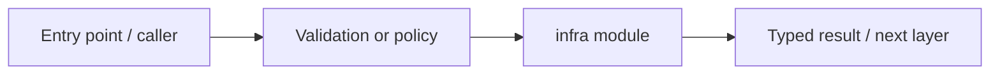

# infra — module technical guide

## Purpose and scope

Infrastructure-as-code and migration assets. Status: **Staging TLS/backup/rollback not independently verified**. See root README and `docs/FINAL_FEATURE_AUDIT.md` for the release state.

## Direct file index

- This folder mainly groups nested packages; consult child README files.

## Architecture and internal workflow

Dev tools -> migration/container -> app runtime.



## Public interfaces and integration

database, docker. Consumers should use these boundaries rather than bypassing permissions, model integrity checks or consent.

## Dependencies and configuration

See compose.yaml and .env.example. Do not commit secrets, patient photographs, model checkpoints or other sensitive artifacts.

## Verification

Run from repository root unless the command is an npm script (run npm scripts from `apps/web`):

```bash
docker compose config
```

These are **recommended commands**, not a claim they were executed during this documentation change. Record commit SHA, test output and independent integration evidence before changing audit state.
