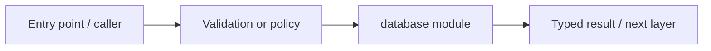

# infra/database — module technical guide

## Purpose and scope

Database migrations and schema bootstrapping. Status: **Never apply schema changes to production without backup**. See root README and `docs/FINAL_FEATURE_AUDIT.md` for the release state.

## Direct file index

- This folder mainly groups nested packages; consult child README files.

## Architecture and internal workflow

Verified deployment config -> alembic upgrade head -> relational tables.



## Public interfaces and integration

migrations, Alembic scripts. Consumers should use these boundaries rather than bypassing permissions, model integrity checks or consent.

## Dependencies and configuration

DERMALENS_DATABASE_URL, alembic.ini. Do not commit secrets, patient photographs, model checkpoints or other sensitive artifacts.

## Verification

Run from repository root unless the command is an npm script (run npm scripts from `apps/web`):

```bash
alembic upgrade head on disposable database
```

These are **recommended commands**, not a claim they were executed during this documentation change. Record commit SHA, test output and independent integration evidence before changing audit state.
