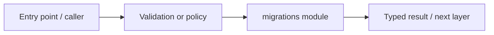

# infra/database/migrations — module technical guide

## Purpose and scope

Alembic environment and versioned change management. Status: **Production migrations require explicit operator review**. See root README and `docs/FINAL_FEATURE_AUDIT.md` for the release state.

## Direct file index

- `env.py` — Python module / executable logic

## Architecture and internal workflow

Alembic env -> ordered revisions -> schema.



## Public interfaces and integration

env.py; versions/*.py. Consumers should use these boundaries rather than bypassing permissions, model integrity checks or consent.

## Dependencies and configuration

alembic.ini, Postgres env, optional test SQLite. Do not commit secrets, patient photographs, model checkpoints or other sensitive artifacts.

## Verification

Run from repository root unless the command is an npm script (run npm scripts from `apps/web`):

```bash
alembic upgrade head
```

These are **recommended commands**, not a claim they were executed during this documentation change. Record commit SHA, test output and independent integration evidence before changing audit state.
