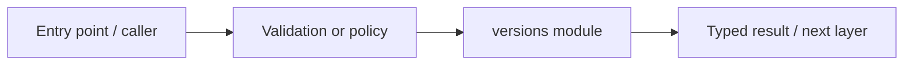

# infra/database/migrations/versions — module technical guide

## Purpose and scope

Immutable historical SQLAlchemy migration revisions. Status: **Generate new revisions for future changes**. See root README and `docs/FINAL_FEATURE_AUDIT.md` for the release state.

## Direct file index

- `0001_initial_accounts.py` — Python module / executable logic
- `0002_feedback_unique.py` — Python module / executable logic

## Architecture and internal workflow

Migration revision chain -> constraints/indexes.



## Public interfaces and integration

0001_initial_accounts.py, 0002_feedback_unique.py. Consumers should use these boundaries rather than bypassing permissions, model integrity checks or consent.

## Dependencies and configuration

Managed by Alembic; do not edit applied revisions. Do not commit secrets, patient photographs, model checkpoints or other sensitive artifacts.

## Verification

Run from repository root unless the command is an npm script (run npm scripts from `apps/web`):

```bash
alembic upgrade head on disposable database
```

These are **recommended commands**, not a claim they were executed during this documentation change. Record commit SHA, test output and independent integration evidence before changing audit state.

## Metadata expiration extension

Bounded privacy housekeeping uses `services/persistence/retention.py` with `scripts/prune_expired_history.py`, `0003_analysis_expiry_index.py` and `tests/test_persistence_retention.py`. Default behavior is dry run; `--execute --confirm-delete` is required for deletion. See `docs/RETENTION_OPERATIONS.md`. No automatic scheduler or image erasure system is implied.
