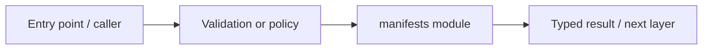

# models/manifests — module technical guide

## Purpose and scope

Versioned model metadata contract. Status: **Schema is not a trained model or validated medical predictor**. See root README and `docs/FINAL_FEATURE_AUDIT.md` for the release state.

## Direct file index

- `model-manifest.schema.json` — validated machine-readable configuration

## Architecture and internal workflow

Manifest -> SHA integrity -> model loader / offline evaluator.



## Public interfaces and integration

model-manifest.schema.json. Consumers should use these boundaries rather than bypassing permissions, model integrity checks or consent.

## Dependencies and configuration

Private .keras/label_map.json files are not committed. Do not commit secrets, patient photographs, model checkpoints or other sensitive artifacts.

## Verification

Run from repository root unless the command is an npm script (run npm scripts from `apps/web`):

```bash
python -m pytest -q tests/test_phase9_artifacts.py
```

These are **recommended commands**, not a claim they were executed during this documentation change. Record commit SHA, test output and independent integration evidence before changing audit state.
