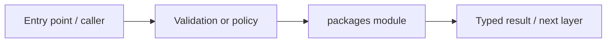

# packages — module technical guide

## Purpose and scope

Cross-cutting contracts and reusable primitives. Status: **No hidden application state or medical decisions**. See root README and `docs/FINAL_FEATURE_AUDIT.md` for the release state.

## Direct file index

- `__init__.py` — Python module / executable logic

## Architecture and internal workflow

Application modules -> shared policy and contracts.



## Public interfaces and integration

common, contracts, security, telemetry. Consumers should use these boundaries rather than bypassing permissions, model integrity checks or consent.

## Dependencies and configuration

Used by API and services. Do not commit secrets, patient photographs, model checkpoints or other sensitive artifacts.

## Verification

Run from repository root unless the command is an npm script (run npm scripts from `apps/web`):

```bash
python -m pytest -q tests/test_phase0_contracts.py
```

These are **recommended commands**, not a claim they were executed during this documentation change. Record commit SHA, test output and independent integration evidence before changing audit state.
