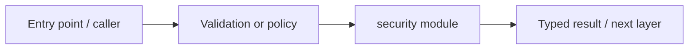

# packages/security — module technical guide

## Purpose and scope

OIDC identity verification, consent helpers and bounded local request limiter. Status: **Do not treat a user-supplied identifier as authenticated**. See root README and `docs/FINAL_FEATURE_AUDIT.md` for the release state.

## Direct file index

- `__init__.py` — Python module / executable logic
- `consent.py` — Python module / executable logic
- `identity.py` — Python module / executable logic
- `oidc.py` — Python module / executable logic
- `rate_limit.py` — Python module / executable logic

## Architecture and internal workflow

Bearer -> JWKS signature -> issuer/audience -> principal -> owner checks.



## Public interfaces and integration

OidcJwtVerifier, Principal, RejectingIdentityVerifier, FixedWindowLimiter. Consumers should use these boundaries rather than bypassing permissions, model integrity checks or consent.

## Dependencies and configuration

Set issuer/audience/JWKS trio; distributed ingress controls pending. Do not commit secrets, patient photographs, model checkpoints or other sensitive artifacts.

## Verification

Run from repository root unless the command is an npm script (run npm scripts from `apps/web`):

```bash
python -m pytest -q tests/test_phase2_backend.py tests/test_api_rate_limits.py
```

These are **recommended commands**, not a claim they were executed during this documentation change. Record commit SHA, test output and independent integration evidence before changing audit state.
