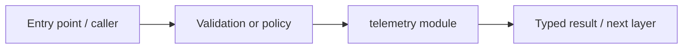

# packages/telemetry — module technical guide

## Purpose and scope

Privacy-constrained in-process operational measurements. Status: **No durable cross-replica monitoring yet**. See root README and `docs/FINAL_FEATURE_AUDIT.md` for the release state.

## Direct file index

- `__init__.py` — Python module / executable logic
- `runtime.py` — Python module / executable logic

## Architecture and internal workflow

Request middleware -> bounded labels -> local health metrics.



## Public interfaces and integration

RuntimeTelemetry. Consumers should use these boundaries rather than bypassing permissions, model integrity checks or consent.

## Dependencies and configuration

No external metrics backend configured. Do not commit secrets, patient photographs, model checkpoints or other sensitive artifacts.

## Verification

Run from repository root unless the command is an npm script (run npm scripts from `apps/web`):

```bash
python -m pytest -q tests/test_phase12_telemetry.py
```

These are **recommended commands**, not a claim they were executed during this documentation change. Record commit SHA, test output and independent integration evidence before changing audit state.
