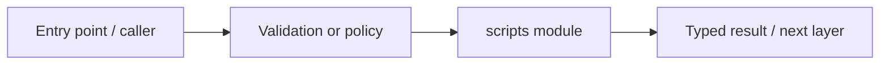

# scripts — module technical guide

## Purpose and scope

Offline evaluation, artifact verification, CLI review and operational smoke. Status: **CLI engineering evidence is not medical release authorization**. See root README and `docs/FINAL_FEATURE_AUDIT.md` for the release state.

## Direct file index

- `check_repository_hygiene.py` — Python module / executable logic
- `evaluate_predictions.py` — Python module / executable logic
- `export_verified_predictions.py` — Python module / executable logic
- `fit_calibration_policy.py` — Python module / executable logic
- `operational_smoke.py` — Python module / executable logic
- `review_candidate.py` — Python module / executable logic
- `review_candidate_with_policy.py` — Python module / executable logic
- `review_population_drift.py` — Python module / executable logic
- `validate_phase0.py` — Python module / executable logic
- `verify_model_package.py` — Python module / executable logic

## Architecture and internal workflow

Private input -> validation -> analysis/report; never upload patient data by default.



## Public interfaces and integration

python -m scripts.<module> entrypoints. Consumers should use these boundaries rather than bypassing permissions, model integrity checks or consent.

## Dependencies and configuration

Per-script CLI arguments; private model/data files not checked into Git. Do not commit secrets, patient photographs, model checkpoints or other sensitive artifacts.

## Verification

Run from repository root unless the command is an npm script (run npm scripts from `apps/web`):

```bash
python -m pytest -q && python -m scripts.validate_phase0
```

These are **recommended commands**, not a claim they were executed during this documentation change. Record commit SHA, test output and independent integration evidence before changing audit state.
