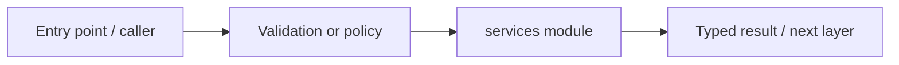

# services — module technical guide

## Purpose and scope

Domain modules separated from HTTP routes. Status: **Offline training/evaluation distinct from public user flow**. See root README and `docs/FINAL_FEATURE_AUDIT.md` for the release state.

## Direct file index

- `__init__.py` — Python module / executable logic

## Architecture and internal workflow

API dependency -> domain service -> validated output.



## Public interfaces and integration

cv, learning, persistence, rag. Consumers should use these boundaries rather than bypassing permissions, model integrity checks or consent.

## Dependencies and configuration

Package-specific optional dependencies. Do not commit secrets, patient photographs, model checkpoints or other sensitive artifacts.

## Verification

Run from repository root unless the command is an npm script (run npm scripts from `apps/web`):

```bash
python -m pytest -q
```

These are **recommended commands**, not a claim they were executed during this documentation change. Record commit SHA, test output and independent integration evidence before changing audit state.
