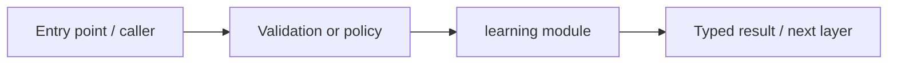
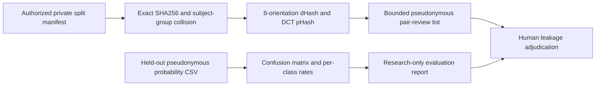

# services/learning — module technical guide

## Purpose and scope

Calibration, audit, drift, curation and offline candidate review. Status: **Review decisions never automatically promote to production**. See root README and `docs/FINAL_FEATURE_AUDIT.md` for the release state.

## Direct file index

- `__init__.py` — Python module / executable logic
- `calibration.py` — Python module / executable logic
- `curation.py` — Python module / executable logic
- `drift.py` — Python module / executable logic
- `evaluation.py` — six-class held-out metrics including complete confusion matrix, sensitivity, specificity, calibration/error summaries
- `leakage_audit.py` — subject-group/byte-duplicate and dual dHash+pHash orientation-aware split leakage checks (review candidates only)
- `feedback.py` — Python module / executable logic
- `ports.py` — Python module / executable logic
- `promotion.py` — Python module / executable logic
- `review_policy.py` — Python module / executable logic

## Architecture and internal workflow

Private predictions -> leakage/consent audit -> metrics -> human gate.



## Public interfaces and integration

abstaining_decision, evaluation, promotion/review helpers. Consumers should use these boundaries rather than bypassing permissions, model integrity checks or consent.

## Dependencies and configuration

Private, rights-cleared evaluation files; no live patient data. Do not commit secrets, patient photographs, model checkpoints or other sensitive artifacts.

## Verification

Run from repository root unless the command is an npm script (run npm scripts from `apps/web`):

```bash
python -m pytest -q tests/test_phase10_evaluation.py tests/test_phase13_improvement.py
```

These are **recommended commands**, not a claim they were executed during this documentation change. Record commit SHA, test output and independent integration evidence before changing audit state.

## Updated pipeline and acceptance tests



Relevant files: `scripts/audit_dataset.py`, `scripts/evaluate_predictions.py`, `tests/test_perceptual_duplicate.py`, `tests/test_evaluation_confusion.py`. No result is a clinical diagnosis or claim of independently established patient-level evaluation.
