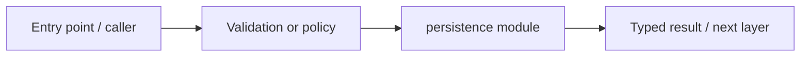

# services/persistence — module technical guide

## Purpose and scope

Database models and owner-scoped transaction functions. Status: **Raw face photographs are not stored; consent purges metadata**. See root README and `docs/FINAL_FEATURE_AUDIT.md` for the release state.

## Direct file index

- `__init__.py` — Python module / executable logic
- `models.py` — Python module / executable logic
- `repository.py` — Python module / executable logic
- `runtime.py` — Python module / executable logic

## Architecture and internal workflow

Verified principal -> SQLAlchemy Session -> PostgreSQL rows.



## Public interfaces and integration

Base, Account, Consent, AnalysisRecord, FeedbackRecord; repository methods. Consumers should use these boundaries rather than bypassing permissions, model integrity checks or consent.

## Dependencies and configuration

DERMALENS_DATABASE_URL; Alembic migrations. Do not commit secrets, patient photographs, model checkpoints or other sensitive artifacts.

## Verification

Run from repository root unless the command is an npm script (run npm scripts from `apps/web`):

```bash
python -m pytest -q tests/test_phase3_persistence.py
```

These are **recommended commands**, not a claim they were executed during this documentation change. Record commit SHA, test output and independent integration evidence before changing audit state.
