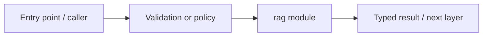

# services/rag — module technical guide

## Purpose and scope

Curated-document retrieval and optional protected language-model adapter. Status: **Public search lexical, not implemented as pgvector semantic RAG**. See root README and `docs/FINAL_FEATURE_AUDIT.md` for the release state.

## Direct file index

- `__init__.py` — Python module / executable logic
- `grok.py` — Python module / executable logic
- `index.py` — Python module / executable logic
- `ports.py` — Python module / executable logic

## Architecture and internal workflow

Markdown -> normalized passage index -> cited results -> optional provider.



## Public interfaces and integration

DocumentationIndex, GrokResponseProvider. Consumers should use these boundaries rather than bypassing permissions, model integrity checks or consent.

## Dependencies and configuration

requirements-rag.txt; server-only GROK_API_KEY for optional feature. Do not commit secrets, patient photographs, model checkpoints or other sensitive artifacts.

## Verification

Run from repository root unless the command is an npm script (run npm scripts from `apps/web`):

```bash
python -m pytest -q tests/test_phase7_rag.py tests/test_integration_docs_search.py
```

These are **recommended commands**, not a claim they were executed during this documentation change. Record commit SHA, test output and independent integration evidence before changing audit state.
