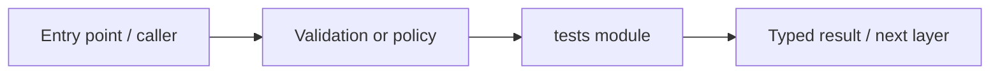

# tests — module technical guide

## Purpose and scope

Automated engineering regression and contract suites. Status: **Passing mocks do not prove real provider or clinical behavior**. See root README and `docs/FINAL_FEATURE_AUDIT.md` for the release state.

## Direct file index

- `test_api_foundation.py` — automated checks
- `test_api_rate_limits.py` — automated checks
- `test_integration_docs_search.py` — automated checks
- `test_offline_drift.py` — automated checks
- `test_offline_research_pipeline.py` — automated checks
- `test_phase0_contracts.py` — automated checks
- `test_phase10_evaluation.py` — automated checks
- `test_phase10_verified_export.py` — automated checks
- `test_phase11_reliability.py` — automated checks
- `test_phase12_telemetry.py` — automated checks
- `test_phase13_improvement.py` — automated checks
- `test_phase13b_review_policy.py` — automated checks
- `test_phase2_backend.py` — automated checks
- `test_phase3_persistence.py` — automated checks
- `test_phase4_image_quality.py` — automated checks
- `test_phase6_feedback.py` — automated checks
- `test_phase7_rag.py` — automated checks
- `test_phase9_artifacts.py` — automated checks
- `test_repository_hygiene.py` — automated checks

## Architecture and internal workflow

API and service -> test fixtures -> assertions.



## Public interfaces and integration

pytest modules and deterministic fixture-based tests. Consumers should use these boundaries rather than bypassing permissions, model integrity checks or consent.

## Dependencies and configuration

requirements-dev.txt and optional package extras. Do not commit secrets, patient photographs, model checkpoints or other sensitive artifacts.

## Verification

Run from repository root unless the command is an npm script (run npm scripts from `apps/web`):

```bash
python -m pytest -q
```

These are **recommended commands**, not a claim they were executed during this documentation change. Record commit SHA, test output and independent integration evidence before changing audit state.

## Metadata expiration extension

Bounded privacy housekeeping uses `services/persistence/retention.py` with `scripts/prune_expired_history.py`, `0003_analysis_expiry_index.py` and `tests/test_persistence_retention.py`. Default behavior is dry run; `--execute --confirm-delete` is required for deletion. See `docs/RETENTION_OPERATIONS.md`. No automatic scheduler or image erasure system is implied.
